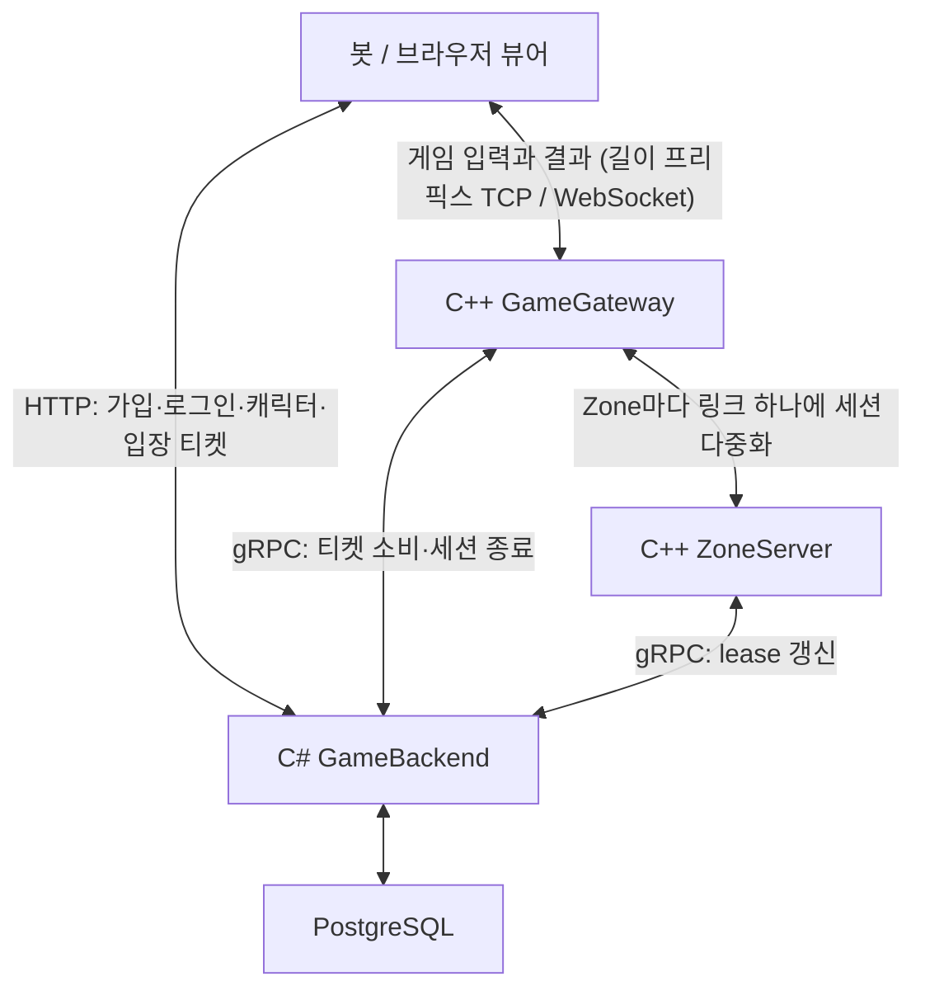
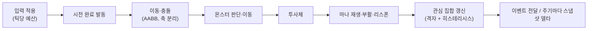
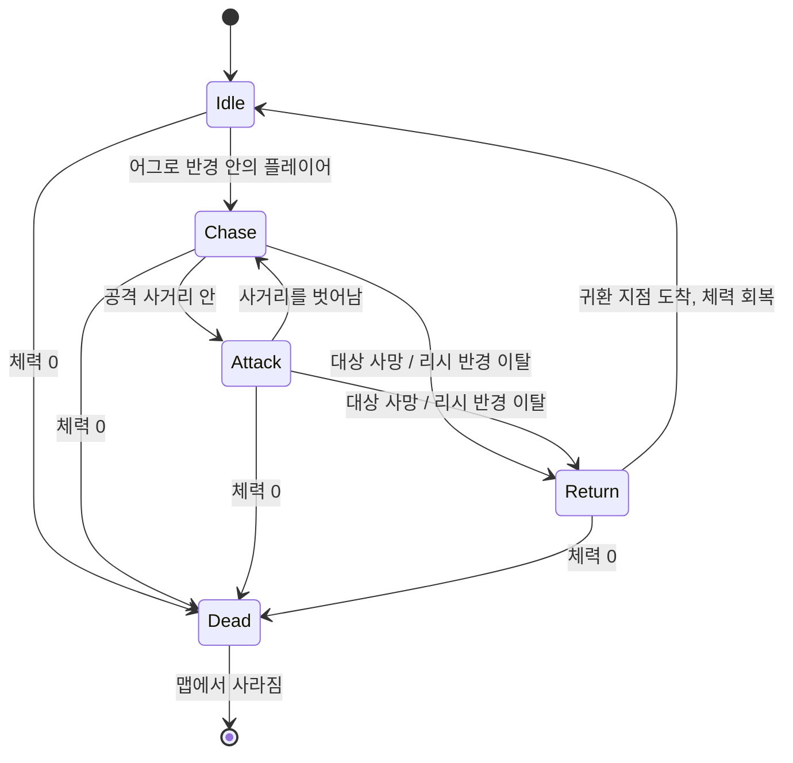

# sa-server

MMORPG 서버 포트폴리오. `sa`는 Server Architecture의 약자다. 미니 PC 한 대에서 구현·운영하며 정합성과 성능을 실측으로 입증하는 것이 목표이고, 단계별로 만들며 각 단계의 결정(ADR), 이유(설계 노트), 작업 서사(피처 문서)를 함께 남긴다. 이 README에는 **지금까지 만든 것**만 적는다. 단계가 끝날 때마다 그 단계의 구조·흐름·측정이 여기에 더해진다.

- 결정 기록: [docs/adr/](docs/adr/) · 설계 노트(왜 이렇게 만들었나): [docs/design-notes/](docs/design-notes/)
- 피처별 작업 기록(곧 진행 기록): [docs/features/](docs/features/) · 작업 중 만난 문제: [docs/issues/](docs/issues/)
- 작업 규칙: [CONTRIBUTING.md](CONTRIBUTING.md)(브랜치·PR 절차), [CLAUDE.md](CLAUDE.md)(코드 규칙)

## 전체 구조



| 프로그램 | 언어 | 책임 |
|---|---|---|
| GameGateway | C++23 | 연결, 프레이밍, 티켓 검증, 세션 상태 기계, Zone 라우팅, 유량 제한 |
| ZoneServer | C++23 | 지역 시뮬레이션(이동·충돌·전투·몬스터 AI·관심 관리), 세션 표, Backend lease 유지 |
| GameBackend | C# / .NET 10 | 가입·로그인, 캐릭터, 입장 티켓과 세션·소유권(WorldDirectory). 모듈형 모놀리스 |
| 브라우저 뷰어 | JavaScript | 2D 뷰어. 같은 `.proto`를 브라우저에서 읽고 WebSocket으로 접속해 WASD로 움직이며, 다른 엔티티를 보간 버퍼로 그린다. 버퍼 길이·인위적 유실·외삽을 조절해 동기화를 눈으로 본다 |
| loadgen | C++23 | 시드 기반 봇. 가입·로그인·캐릭터·티켓을 거쳐 Gateway로 입장해 걷고, 받은 스냅샷이 서로 모순되지 않는지 검사한다. 같은 두뇌(Wanderer)가 Zone 안의 프로세스 봇으로도 돈다 |

모든 메시지는 `contracts/`의 Protobuf가 단일 출처다(ADR-0004).

## 데이터의 기준

| 데이터 | 실행 중 변경 주체 | 기준 저장 |
|---|---|---|
| 위치·속도, 관심 집합, 체력·마나, 시전·쿨타임, 투사체, 몬스터 상태 | Zone | 메모리. 재시작하면 초기화 |
| 계정, 캐릭터 | Backend | PostgreSQL |
| 입장 티켓, 세션, 캐릭터의 소유 Zone과 소유권 세대(owner_epoch), 프로세스 lease | Backend WorldDirectory | PostgreSQL |

규칙은 DB 제약으로도 지킨다. 티켓 소비는 조건부 UPDATE, 캐릭터당 활성 세션 하나는 부분 유일 인덱스, 소유권 변경은 같은 트랜잭션.

## 네트워크와 입장

| 구간 | 선택 |
|---|---|
| 클라이언트 ↔ Backend | HTTP(JSON). 브라우저는 설정한 출처(`Cors:AllowedOrigins`)만 허용하고, 입장 응답에 Gateway의 WebSocket 포트를 함께 준다 |
| 클라이언트 ↔ Gateway | 길이 프리픽스 TCP(봇·네이티브). 브라우저는 같은 Protobuf 메시지를 WebSocket 바이너리 프레임으로(두 번째 포트). 프레임 상한 64 KiB, 연결당 초당 메시지 상한 |
| Gateway ↔ Zone | Zone마다 영속 연결 하나에 세션을 다중화 |
| Zone·Gateway ↔ Backend | gRPC 비동기 호출, 모든 호출에 마감 시간 |

TCP는 초기 개발과 디버깅을 위한 선택이다(설계 노트 01·02).

입장 순서(ADR-0005, 설계 노트 04):
1. 클라이언트가 Backend에 로그인하고 캐릭터를 고르면 Backend가 소유를 확인하고 짧게 유효한 **서명 티켓**을 발급한다.
2. 클라이언트가 Gateway에 티켓을 낸다. Gateway는 서명·만료를 먼저 거른다.
3. Backend가 **한 트랜잭션에서** 티켓을 1회 소비하고, 같은 캐릭터의 다른 활성 세션을 거절하고, lease가 살아 있는 Zone을 배정한다.
4. Gateway가 세션을 그 Zone에 붙이고, 이후 입력과 출력을 중계한다.

Gateway의 세션 로직은 I/O 없는 상태 기계라서 모든 전이를 소켓 없이 테스트한다. 세션 로직은 전송을 모른다. TCP와 WebSocket은 같은 `MessageConnection` 인터페이스 뒤에 있고, 둘 다 한 가지 TCP 바이트 스트림 구현(읽기 루프, 순서 있는 쓰기 큐, 종료 통지)을 쓴다(ADR-0004).

## Zone의 한 틱

한 Zone의 상태는 하나의 논리 실행 흐름이 바꾼다. 시뮬레이션 코어는 소켓·시계·난수를 모르는 순수 라이브러리다(ADR-0008).



| 설정 | 값(측정 전 기본값) |
|---|---|
| 시뮬레이션 | 20 Hz(틱당 50 ms) |
| 스냅샷 | 10 Hz |
| 관심 반경 진입 / 이탈 | 40 m / 45 m |
| 몬스터 판단 | 5 Hz, 개체마다 시점을 엇갈림. 이동은 매 틱 |
| lease 갱신 / 만료 | 5 s / 15 s |

틱은 Asio 타이머가 이전 마감 기준으로 깨운다. 밀리면 상한까지만 따라잡고 나머지는 버리고 센다. 플레이어마다 "알려준 집합"과의 차이(spawned·updated·despawned)만 보낸다. 수치는 `game-data/`와 `deploy/compose/config/`에 있다.

## 전투

스킬·클래스·몬스터는 코드가 아니라 `game-data/`의 데이터다. 로더가 네 파일을 하나의 콘텐츠 묶음으로 읽고, 맵의 몬스터 스폰까지 서로 맞는지 검증한다. 시간 값은 밀리초로 두고, 틱 수로 바꾸는 것은 틱 속도를 아는 Zone이 한다.

| 데이터 | 정의하는 것 |
|---|---|
| 클래스 | 체력, 마나와 재생 속도, 쓸 수 있는 스킬 |
| 스킬 | 판정 종류(대상 지정 또는 투사체), 마나 비용, 쿨타임, 시전 시간, 사거리, 피해, 투사체 속도·반경 |
| 몬스터 | 체력, 이동 속도, 어그로·리시 반경, 공격 사거리·피해·주기, 리스폰 시간 |
| 몬스터 스폰 | 맵마다 템플릿, 귀환 지점, 마릿수 |
| 콘텐츠 버전 | game-data가 시뮬레이션 결과나 보상을 바꾸면 올리는 식별자 |

없는 스킬을 가리키는 클래스, 속도·반경이 빠진 투사체 스킬, 모르는 템플릿이나 맵 밖을 가리키는 몬스터 스폰은 로드 단계에서 거절한다.

Zone은 시작할 때 콘텐츠를 읽고 버전을 로그에 남긴다. 콘텐츠에 없는 클래스의 캐릭터는 입장 단계에서 거절한다(`UNKNOWN_CLASS`). 체력이 없는 캐릭터를 맵에 세우지 않기 위해서다.

스킬 요청은 Zone 틱 안에서 이 순서로 처리한다. 클라이언트는 요청과 피해를 결정하지 않는다.

1. **중복 확인.** 요청 ID별 최근 결과를 기억해, 다시 온 요청은 재적용하지 않고 같은 답을 준다.
2. **검증.** 사망, 시전 중, 배우지 않은 스킬, 마나 부족, 쿨타임, 대상, 사거리를 본다. 실패하면 사유와 함께 거절한다.
3. **시전.** 마나를 먼저 쓴다. 같은 마나로 두 번 시전하지 못하게 하기 위해서다. 시전 시간 동안 이동을 멈추고, 그동안 들어온 이동 입력은 시전이 끝나면 적용한다.
4. **발동 재검증.** 시전 시간이 끝나면 쿨타임을 시작하고, 대상이 죽거나 멀어지지 않았는지 다시 본다. 실패해도 쓴 마나는 돌려주지 않는다.
5. **판정.** 대상 지정 스킬은 대상 몬스터에 바로 피해를 준다. 투사체는 매 틱 날아가며 처음 닿은 몬스터에 피해를 주고, 사거리 끝에서 사라진다.
6. **전달.** 피해 이벤트는 대상을 시야에 둔 플레이어와 공격자에게 간다. 받는 사람은 Zone이 정하고, 호스트는 직렬화만 한다.

사망은 생명주기마다 한 번만 처리한다. 이미 죽은 대상에 들어온 피해는 무시한다. 죽은 플레이어는 정해진 시간 뒤 스폰 지점에서 체력과 마나를 채워 부활한다. 몬스터는 죽으면 맵에서 사라지고, 리스폰 시간 뒤 귀환 지점에서 새 엔티티로 생긴다.



귀환하면 체력을 모두 채운다. 리시 반경을 이용해 몬스터를 조금씩 깎아 잡는 것을 막기 위해서다.

## 소유권과 lease

- Backend가 캐릭터마다 소유 Zone 인스턴스와 증가하는 소유권 세대(owner_epoch)를 기록한다. Zone 프로세스는 재시작하면 새 인스턴스 ID를 받는다.
- Zone과 Gateway는 Backend lease를 주기적으로 갱신한다. lease가 끊긴 Zone에는 배정하지 않는다.
- Zone은 lease를 잃으면 모든 세션을 내보내고 플레이어를 지운다. 권한 없는 프로세스가 상태를 바꾸지 않는다.
- Gateway의 Zone 링크가 끊기면 그 Zone의 세션을 끝내고 Backend에 세션 종료를 알린다.

## 검증

**end-to-end**: `scripts/e2e-local.sh` 한 번으로 PostgreSQL(compose) + Backend + Zone + Gateway를 띄우고 봇 5개가 로그인 → 티켓 → Gateway → Zone 입장까지 TCP로 통과하는지, 서로를 보는지, 끝난 뒤 열린 세션이 0인지 판정한다(종료 코드가 판정). 봇의 월드 모델은 스냅샷마다 모순(모르는 엔티티의 갱신, 이미 보이는 엔티티의 재등장, 자기 자신이 시야에 등장, 입력 순번 역행)을 세고, 하나라도 있으면 실패다.

**정합성 테스트**: [tests/integration/README.md](tests/integration/README.md)의 시나리오를 실제 PostgreSQL(Testcontainers)에서 돌린다. HTTP 응답 코드가 아니라 DB 상태를 단언한다. 지금 통과하는 것: 티켓 1회 소비, 두 Gateway의 동시 Redeem 중 한 건만 승인, 캐릭터당 세션 하나, lease 만료 Zone 배정 거절.

## 기술 선택

| 기술 | 이유 |
|---|---|
| C++23(GCC 14), CMake, Asio | 네트워크·메모리·실시간 루프를 직접 구현하고 측정(ADR-0003) |
| C# / .NET 10, ASP.NET Core, Npgsql + Dapper | 인증·API·트랜잭션. SQL을 그대로 리뷰한다(ADR-0007) |
| Protobuf, gRPC | C++와 C#의 단일 계약, 타입 있는 내부 호출(ADR-0004) |
| PostgreSQL | 티켓·세션·소유권을 한 트랜잭션과 제약으로 검증 |

라이브러리 버전은 vcpkg baseline(C++)과 `Directory.Packages.props`·잠금 파일(.NET), 도구 버전은 CI 설정과 `global.json`에 고정한다.

## 빌드

```bash
export VCPKG_ROOT=/opt/vcpkg
scl enable gcc-toolset-14 -- cmake --preset dev     # 프리셋: dev / release / asan / tsan / tidy
scl enable gcc-toolset-14 -- cmake --build --preset dev
ctest --preset dev
dotnet build server/dotnet/GameServer.slnx
dotnet test  server/dotnet/GameServer.slnx          # 통합 테스트는 Docker(Testcontainers)
scripts/check-format.sh

# 로컬 실행용 비밀 값과 DB (저장소에 넣지 않는다)
cp deploy/compose/.env.example deploy/compose/.env   # 비밀번호 수정

# 전체 스택 end-to-end: 봇이 로그인 → 티켓 → Gateway → Zone 입장, 서로를 보는지 검증
scripts/e2e-local.sh

# 대화형: 스택을 띄우고 브라우저 뷰어로 접속 (http://localhost:8080/tools/viewer/)
scripts/dev-stack.sh up && scripts/viewer.sh
scripts/dev-stack.sh down

# 시뮬레이션만 돌려보기: 네트워크 없이 프로세스 안에서 봇 200개
SA_ZONE__DEV__LOCAL_BOTS=200 build/dev/server/cpp/zone/server/zone_server --config deploy/compose/config/zone-a.toml
```

## 저장소 구성

```
contracts/         Protobuf 계약 (game / backend / events / internal)
server/cpp/        common, gateway, zone(sim + data + server)
server/dotnet/     Contracts, GameBackend, Migrator, tests
database/          SQL 마이그레이션
game-data/         맵·이동·전투 규칙, 클래스·스킬·몬스터, 콘텐츠 버전
deploy/compose/    로컬 PostgreSQL과 프로세스 설정
tools/loadgen/     봇 두뇌(bot/)와 네트워크 봇 클라이언트(client/, 프로필)
scripts/           end-to-end, 대화형 스택(dev-stack), 뷰어 정적 서버, 형식 검사
tools/viewer/      브라우저 2D 뷰어
tests/integration  정합성 시나리오 목록
docs/              ADR, 설계 노트, 피처 문서, 이슈
```
