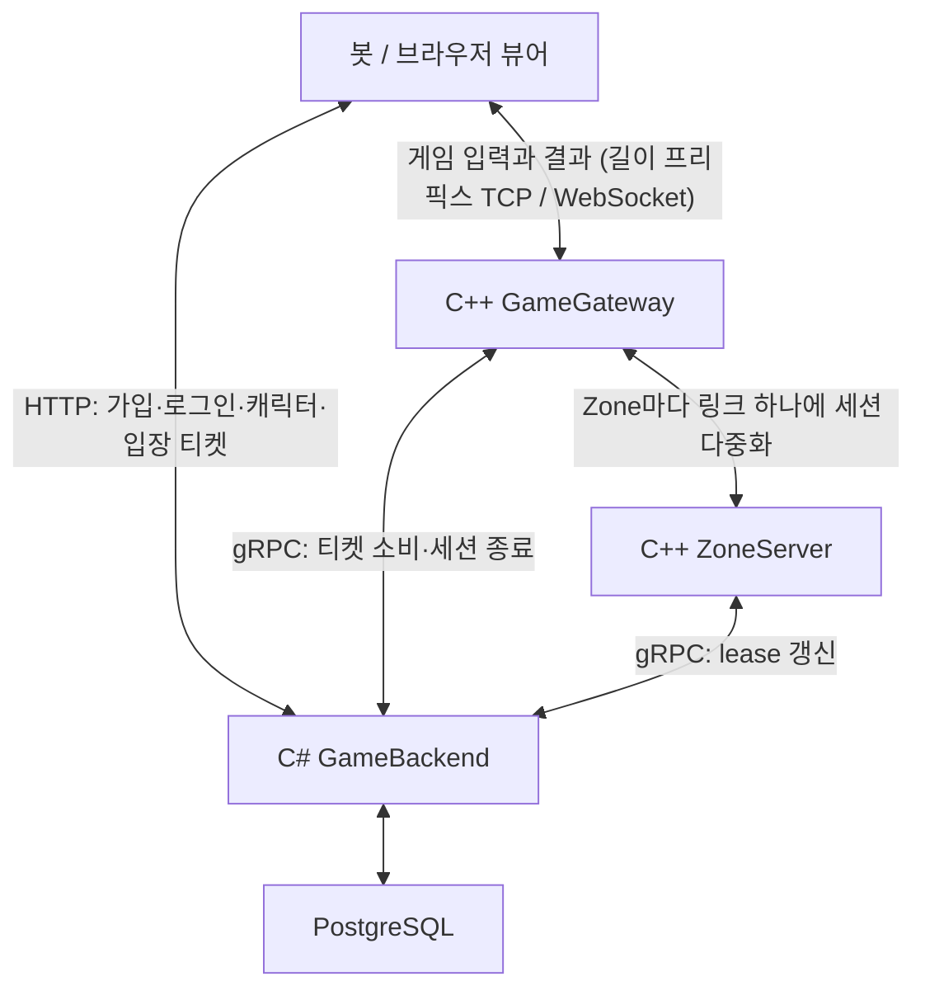
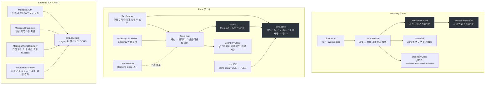
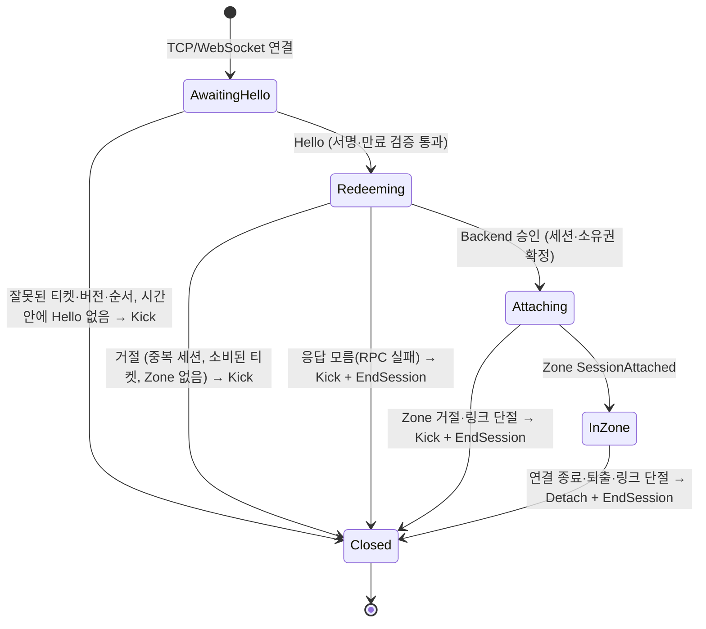
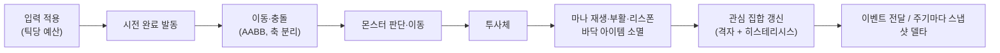
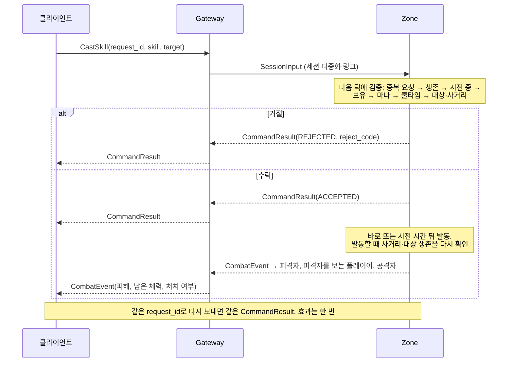
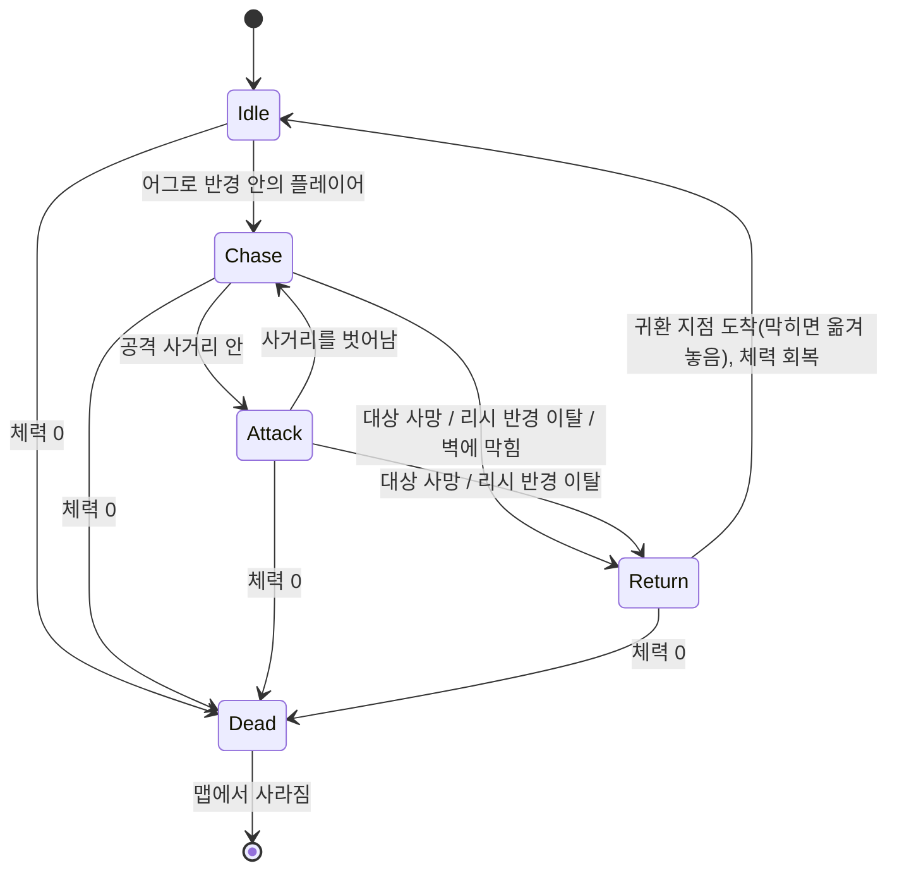
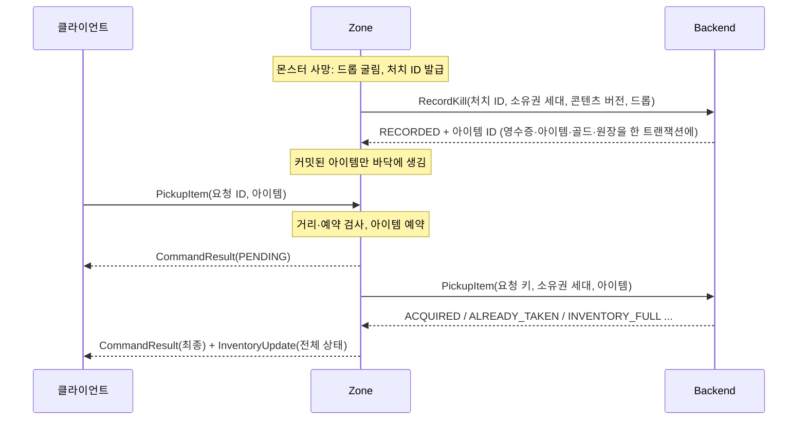
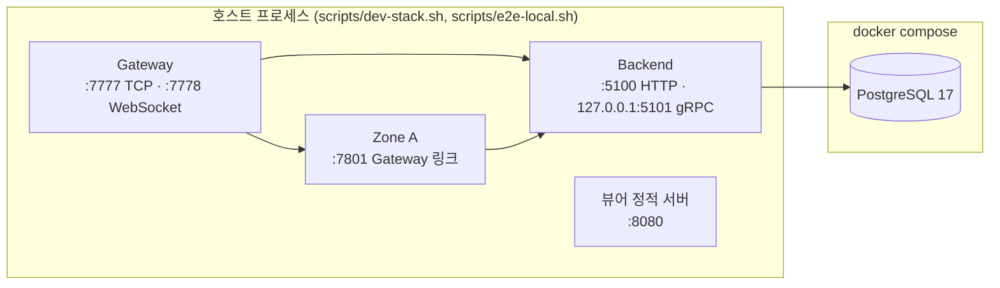

# sa-server

MMORPG 서버 포트폴리오. `sa`는 Server Architecture의 약자다. 미니 PC 한 대에서 구현·운영하며 정합성과 성능을 실측으로 입증하는 것이 목표이고, 단계별로 만들며 각 단계의 결정(ADR), 이유(설계 노트), 작업 서사(피처 문서)를 함께 남긴다. 이 README에는 **지금까지 만든 것**만 적는다. 단계가 끝날 때마다 그 단계의 구조·흐름·측정이 여기에 더해진다.

- 결정 기록: [docs/adr/](docs/adr/) · 설계 노트(왜 이렇게 만들었나): [docs/design-notes/](docs/design-notes/) · 회고 리뷰: [docs/reviews/](docs/reviews/)
- 피처별 작업 기록(곧 진행 기록): [docs/features/](docs/features/) · 작업 중 만난 문제: [docs/issues/](docs/issues/)
- 작업 규칙: [CONTRIBUTING.md](CONTRIBUTING.md)(브랜치·PR 절차), [CLAUDE.md](CLAUDE.md)(코드 규칙)

## 전체 구조



| 프로그램 | 언어 | 책임 |
|---|---|---|
| GameGateway | C++23 | 연결, 프레이밍, 티켓 검증, 세션 상태 기계, Zone 라우팅, 유량 제한 |
| ZoneServer | C++23 | 지역 시뮬레이션(이동·충돌·전투·몬스터 AI·관심 관리), 드롭 굴림·바닥 아이템·획득 예약과 Backend 정산, 세션 표, Backend lease 유지 |
| GameBackend | C# / .NET 10 | 가입·로그인, 캐릭터, 입장 티켓과 세션·소유권(WorldDirectory), 자산(Economy: 처치 기록·획득·조회). 모듈형 모놀리스 |
| 브라우저 뷰어 | JavaScript | 2D 뷰어. 같은 `.proto`를 브라우저에서 읽고 WebSocket으로 접속해 WASD로 움직이며, 다른 엔티티를 보간 버퍼로 그린다. 버퍼 길이·인위적 유실·외삽을 조절해 동기화를 눈으로 본다. 몬스터·투사체·체력 막대를 그리고, Space·E로 스킬을 쓰고 전투 로그를 띄운다 |
| loadgen | C++23 | 시드 기반 봇. 가입·로그인·캐릭터·티켓을 거쳐 Gateway로 입장하고, 받은 스냅샷이 서로 모순되지 않는지 검사한다. 역할은 배회(Wanderer)와 전투(Fighter)다. 전투 봇은 보이는 가장 가까운 몬스터에 다가가 사거리 안에서 주기적으로 공격하고, 시전 수락·거절·처치·사망을 센다. 배회 두뇌는 Zone 안의 프로세스 봇으로도 돈다 |

모든 메시지는 `contracts/`의 Protobuf가 단일 출처다(ADR-0004).

### 프로세스 내부

각 프로세스 안에서 무엇이 무엇을 호출하는지 보여 준다. 회색 상자는 I/O를 모르는 순수 코드이고, 나머지는 소켓·타이머·DB를 다룬다.



## 데이터의 기준

| 데이터 | 실행 중 변경 주체 | 기준 저장 |
|---|---|---|
| 위치·속도, 관심 집합, 체력·마나, 시전·쿨타임, 투사체, 몬스터 상태, 바닥 아이템 표시와 획득 예약 | Zone | 메모리. 재시작하면 초기화 |
| 계정, 캐릭터 | Backend | PostgreSQL |
| 입장 티켓, 세션, 캐릭터의 소유 Zone과 소유권 세대(owner_epoch), 프로세스 lease | Backend WorldDirectory | PostgreSQL |
| 아이템, 인벤토리, 지갑, 원장, 처치 영수증, 요청 결과 | Backend Economy | PostgreSQL |

규칙은 DB 제약으로도 지킨다. 티켓 소비는 조건부 UPDATE, 캐릭터당 활성 세션 하나는 부분 유일 인덱스, 소유권 변경은 같은 트랜잭션.

Backend가 PostgreSQL에 두는 기준 상태와 그것을 지키는 제약이다.

```mermaid
erDiagram
    accounts ||--o{ characters : owns
    worlds ||--o{ characters : contains
    accounts ||--o{ entry_tickets : issued_for
    characters ||--o{ entry_tickets : issued_for
    characters ||--o| character_ownership : simulated_by
    zone_leases ||--o{ character_ownership : holds
    characters ||--o{ character_sessions : connects_as
    gateway_leases ||--o{ character_sessions : hosted_by
    characters ||--o{ item_instances : holds
    characters ||--|| inventories : has
    characters ||--o{ wallets : has
    characters ||--o{ economy_ledger : records
    characters ||--o{ kill_receipts : killed_by

    accounts {
        bigint account_id PK
        text username UK "형식 CHECK"
        text password_hash
    }
    characters {
        bigint character_id PK
        bigint world_id FK
        bigint account_id FK
        text name "world별 대소문자 무시 UNIQUE"
        int class_id
    }
    entry_tickets {
        bytea ticket_id PK "16바이트"
        timestamptz expires_at
        timestamptz redeemed_at "조건부 UPDATE로 1회 소비"
    }
    character_ownership {
        bigint world_id PK
        bigint character_id PK
        int zone_id
        bytea zone_instance_id FK
        bigint owner_epoch "펜싱 토큰, 단조 증가"
        text state "active | transferring | released"
    }
    character_sessions {
        bytea gateway_session_id PK
        bytea gateway_instance_id FK
        bigint character_id FK "ended_at IS NULL 인 행은 캐릭터당 1개"
        timestamptz ended_at
    }
    zone_leases {
        bytea zone_instance_id PK
        int zone_id
        timestamptz lease_expires_at
    }
    gateway_leases {
        bytea gateway_instance_id PK
        timestamptz lease_expires_at
    }
    item_instances {
        bytea item_instance_id PK
        text location "ground | inventory, 위치별 필수 열 CHECK"
        bigint owner_character_id FK
        int slot_no "캐릭터별 칸당 1개 (부분 UNIQUE)"
        int zone_id "바닥일 때"
    }
    inventories {
        bigint character_id PK
        int capacity
        int version
    }
    wallets {
        bigint character_id PK
        text currency PK
        bigint balance "CHECK >= 0"
    }
    economy_ledger {
        bigint entry_id PK
        text kind "덧붙이기만"
    }
    kill_receipts {
        bytea kill_id PK "몬스터 생명주기당 1개"
        bigint owner_epoch
        text content_version
    }
    command_results {
        text scope PK
        bytea request_id PK
        bytea request_hash "같은 ID 다른 본문 판별"
        jsonb payload "재시도에 돌려줄 결과"
    }
```



## 네트워크와 입장

| 구간 | 선택 |
|---|---|
| 클라이언트 ↔ Backend | HTTP(JSON). 브라우저는 설정한 출처(`Cors:AllowedOrigins`)만 허용하고, 입장 응답에 Gateway의 WebSocket 포트를 함께 준다. 가입·로그인은 주소당 분당 시도 상한(`Auth:CredentialAttemptsPerMinutePerAddress`)이 있고, 봇 전원을 한 주소에서 띄우는 로컬 스크립트만 올린다 |
| 클라이언트 ↔ Gateway | 길이 프리픽스 TCP(봇·네이티브). 브라우저는 같은 Protobuf 메시지를 WebSocket 바이너리 프레임으로(두 번째 포트). 프레임 상한 64 KiB, 연결당 초당 메시지 상한 |
| Gateway ↔ Zone | Zone마다 영속 연결 하나에 세션을 다중화 |
| Zone·Gateway ↔ Backend | gRPC 비동기 호출, 모든 호출에 마감 시간 |

TCP는 초기 개발과 디버깅을 위한 선택이다(설계 노트 01·02).

입장 순서(ADR-0005, 설계 노트 04):
1. 클라이언트가 Backend에 로그인하고 캐릭터를 고르면 Backend가 소유를 확인하고 짧게 유효한 **서명 티켓**을 발급한다.
2. 클라이언트가 Gateway에 티켓을 낸다. Gateway는 서명·만료를 먼저 거른다.
3. Backend가 **한 트랜잭션에서** 티켓을 1회 소비하고, 같은 캐릭터의 다른 활성 세션을 거절하고, lease가 살아 있는 Zone을 배정한다.
4. Gateway가 세션을 그 Zone에 붙이고, 이후 입력과 출력을 중계한다.

Gateway의 세션 하나가 거치는 상태는 아래와 같다.



Gateway의 세션 로직은 I/O 없는 상태 기계라서 모든 전이를 소켓 없이 테스트한다. 세션 로직은 전송을 모른다. TCP와 WebSocket은 같은 `MessageConnection` 인터페이스 뒤에 있고, 둘 다 한 가지 TCP 바이트 스트림 구현(읽기 루프, 순서 있는 쓰기 큐, 종료 통지)을 쓴다(ADR-0004).

- **입장 중에 떠난 클라이언트**: Backend의 답은 세션이 닫힌 뒤에도 상태 기계로 간다. 늦게 온 승인은 바로 세션 종료(EndSession)로 끝낸다. 그대로 두면 그 캐릭터는 이 Gateway가 사는 동안 어디로도 다시 들어오지 못한다. RPC가 실패해 결과를 모르면 Backend가 이미 커밋했을 수 있으니 세션 종료를 보낸다. 없는 세션을 끝내는 것은 아무 일도 하지 않는다.
- **시간 제한**: 연결을 받은 때부터 정해진 시간(`protocol.hello_timeout_ms`, WebSocket 핸드셰이크 포함) 안에 올바른 Hello가 없으면 내보낸다. 아무것도 보내지 않는 소켓이 연결 상한을 채우지 못하게 하기 위해서다.
- **닫기**: 닫는 쪽은 남은 데이터를 보내고 송신만 먼저 끊은 뒤, 상대가 닫을 때까지 들어오는 바이트를 읽어 버린다. 읽지 않은 데이터를 둔 채 소켓을 닫으면 커널이 리셋을 보내 마지막 메시지(킥)가 사라질 수 있기 때문이다. 클라이언트 연결은 그 기다림에 상한(`protocol.close_linger_ms`)이 있어, 읽지 않는 클라이언트도 결국 연결과 자리를 내놓는다.
- **종료**: SIGTERM을 받으면 새 연결을 받지 않고 모든 세션을 내보낸 뒤, 정해진 시간(RPC 마감보다 길게) 뒤에 Zone 링크를 닫는다. 이벤트 루프를 강제로 멈추지 않고 모든 연결이 닫히고 진행 중인 RPC가 답할 때까지 기다린다. 각각 상한이 있어 끝은 정해져 있고, 늦게 끝난 RPC가 사라진 이벤트 루프에 결과를 넘기는 일이 없다.

## Zone의 한 틱

한 Zone의 상태는 하나의 논리 실행 흐름이 바꾼다. 시뮬레이션 코어는 소켓·시계·난수를 모르는 순수 라이브러리다(ADR-0008).



| 설정 | 값(측정 전 기본값) |
|---|---|
| 시뮬레이션 | 20 Hz(틱당 50 ms) |
| 스냅샷 | 10 Hz |
| 관심 반경 진입 / 이탈 | 40 m / 45 m |
| 몬스터 판단 | 5 Hz, 개체마다 시점을 엇갈림. 이동은 매 틱 |
| lease 갱신 / 만료 | 5 s / 15 s |

틱은 Asio 타이머가 이전 마감 기준으로 깨운다. 밀리면 상한까지만 따라잡고 나머지는 버리고 센다. 수치는 `game-data/`와 `deploy/compose/config/`에 있다.

- **입력**: 좌표가 NaN이나 무한대인 입력은 시뮬레이션에 닿기 전에 버리고 센다. 사거리 판정도 NaN이면 거짓이 되도록 쓴다. 이동은 쌓지 않는다. 플레이어마다 가장 최근 이동 하나만 다음 틱을 기다린다. 이동은 변위가 아니라 방향(의도)이라 중간 입력을 건너뛰어도 결과가 같다. 시전·획득은 도착 순서대로 틱당 예산만큼 처리한다. 한 플레이어가 기다리게 할 수 있는 시전·획득에는 상한이 있다. 넘치면 처리하지 않고 결과 "모름"을 돌려주고, 클라이언트는 같은 요청 ID로 다시 보낸다.
- **종료**: SIGTERM을 받으면 모든 세션을 내보내고 시뮬레이션을 멈춘 뒤, 정해진 시간 뒤에 Gateway 링크를 닫는다. 이벤트 루프를 강제로 멈추지 않는다. 링크가 닫히고(상한 있음) 진행 중인 경제 호출이 재시도까지 끝나 답할 때까지 기다리므로, 처리 중이던 처치와 획득도 정산된다.
- **스냅샷**: 플레이어마다 "알려준 집합"과의 차이(spawned·updated·despawned)만 보낸다. 엔티티는 스냅샷 내용(위치, 속도, 체력)이 마지막으로 바뀐 틱을, 플레이어는 이전 스냅샷의 틱을 기록한다. 그래서 스냅샷 사이의 틱에 일어난 변화와 정지도 다음 스냅샷에 실린다.

## 전투

스킬·클래스·몬스터는 코드가 아니라 `game-data/`의 데이터다. 로더가 네 파일을 하나의 콘텐츠 묶음으로 읽고, 맵의 몬스터 스폰까지 서로 맞는지 검증한다. 시간 값은 밀리초로 두고, 틱 수로 바꾸는 것은 틱 속도를 아는 Zone이 한다.

| 데이터 | 정의하는 것 |
|---|---|
| 클래스 | 체력, 마나와 재생 속도, 쓸 수 있는 스킬 |
| 스킬 | 판정 종류(대상 지정 또는 투사체), 마나 비용, 쿨타임, 시전 시간, 사거리, 피해, 투사체 속도·반경 |
| 몬스터 | 체력, 이동 속도, 어그로·리시 반경, 공격 사거리·피해·주기, 리스폰 시간 |
| 몬스터 스폰 | 맵마다 템플릿, 귀환 지점, 마릿수 |
| 콘텐츠 버전 | game-data가 시뮬레이션 결과나 보상을 바꾸면 올리는 식별자 |

없는 스킬을 가리키는 클래스, 속도·반경이 빠진 투사체 스킬, 모르는 템플릿이나 맵 밖을 가리키는 몬스터 스폰, NaN·무한대 같은 유한하지 않은 숫자는 로드 단계에서 거절한다. Zone을 만들 때는 플레이어 스폰 지점과 몬스터 귀환 지점이 걸을 수 있는 곳인지 이동과 같은 충돌 규칙(몸 반경만큼 장애물과 맵 가장자리에서 떨어짐)으로 본다. 벽에 붙은 스폰에서는 움직일 수 없기 때문이다.

Zone은 시작할 때 콘텐츠를 읽고 버전을 로그에 남긴다. 콘텐츠에 없는 클래스의 캐릭터는 입장 단계에서 거절한다(`UNKNOWN_CLASS`). 체력이 없는 캐릭터를 맵에 세우지 않기 위해서다.

스킬 요청은 Zone 틱 안에서 이 순서로 처리한다. 클라이언트는 요청과 피해를 결정하지 않는다.

1. **중복 확인.** 요청 ID가 없으면 거절한다. 플레이어마다 최근 확정 결과를 계약이 정한 개수(`COMMAND_RETRY_WINDOW`)만큼 기억해, 다시 온 요청은 재적용하지 않고 같은 답을 준다.
2. **검증.** 사망, 시전 중, 배우지 않은 스킬, 마나 부족, 쿨타임, 대상, 사거리를 본다. 실패하면 사유와 함께 거절한다.
3. **시전.** 마나를 먼저 쓴다. 같은 마나로 두 번 시전하지 못하게 하기 위해서다. 시전 시간 동안 이동을 멈추고, 그동안 들어온 이동 입력은 시전이 끝나면 적용한다.
4. **발동 재검증.** 시전 시간이 끝나면 쿨타임을 시작하고, 대상이 죽거나 멀어지지 않았는지 다시 본다. 실패해도 쓴 마나는 돌려주지 않는다.
5. **판정.** 대상 지정 스킬은 대상 몬스터에 바로 피해를 준다. 투사체는 매 틱 날아가며 처음 닿은 몬스터에 피해를 주고, 사거리 끝에서 사라진다.
6. **전달.** 피해 이벤트는 피격자 자신, 피격자를 시야에 둔 플레이어, 공격자에게 간다. 받는 사람은 Zone이 정하고, 호스트는 직렬화만 한다.

클라이언트는 스킬을 `CastSkill`(요청 ID, 스킬, 대상 엔티티 또는 방향)로 요청하고, 아래를 받는다.

| 메시지 | 내용 |
|---|---|
| `CommandResult` | 요청 ID별 수락 또는 거절 사유. 같은 ID로 다시 보내면 같은 답이 온다 |
| `CombatEvent` | 공격자, 피격자, 스킬, 피해, 남은 체력, 처치 여부 |
| 스냅샷 | 보이는 엔티티의 종류·위치·체력. 자기 체력과 마나는 따로 담는다. 다른 플레이어의 마나는 보내지 않는다 |



사망은 생명주기마다 한 번만 처리한다. 이미 죽은 대상에 들어온 피해는 무시한다. 죽은 플레이어는 정해진 시간 뒤 스폰 지점에서 체력과 마나를 채워 부활한다. 몬스터는 죽으면 맵에서 사라지고, 리스폰 시간 뒤 귀환 지점에서 새 엔티티로 생긴다.



귀환하면 체력을 모두 채운다. 리시 반경을 이용해 몬스터를 조금씩 깎아 잡는 것을 막기 위해서다. 몬스터는 경로 탐색 없이 목표로 곧장 걷고 벽을 따라 미끄러진다. 그래서 정해진 시간 동안 일정 거리를 움직이지 못하면 벽에 막힌 것으로 보고, 추격 중이면 귀환하고 귀환 중이면 귀환 지점으로 옮겨 놓는다. 막힘은 목표와의 거리가 아니라 몬스터 자신의 이동으로 판단한다. 더 빠른 플레이어를 쫓는 것은 막힌 것이 아니고, 그 추격은 리시 반경이 끝낸다.

같은 틱 안에서 서로 영향을 주는 처리(시전 발동, 투사체, 몬스터 판단, 부활)는 엔티티 ID 순서로 돈다. 두 공격이 한 틱에 같은 몬스터를 잡으면 먼저 생긴 공격이 처치를 가져가고, 처치 기록은 하나다. 검증 순서, 투사체 터널링, 생명주기당 한 번의 사망을 왜 이렇게 만들었는지는 [설계 노트 06](docs/design-notes/06-combat.md)에 있다.

## 자산과 멱등성

아이템과 재화의 기준은 Backend의 PostgreSQL이다. 자산 규칙은 애플리케이션 검사만이 아니라 테이블 제약으로도 지킨다. Zone과 Backend 사이의 계약은 `contracts/backend/economy.proto`의 Economy 서비스로, 처치 기록·아이템 획득·캐릭터 자산 조회 세 호출이다. 클라이언트는 획득이나 소비 뒤 자기 인벤토리와 지갑의 전체 상태(`InventoryUpdate`)를 받는다. 전체를 보내므로 하나가 유실돼도 다음 것이 대체한다.

| 테이블 | 지키는 것 |
|---|---|
| `item_instances` | 아이템 하나는 바닥이나 정확히 한 인벤토리 칸에만 있다(CHECK). 칸 하나에 아이템 하나(부분 유일 인덱스) |
| `inventories` | 용량과 버전. 바뀔 때마다 버전이 오르고, 클라이언트는 버전으로 최신인지 판단한다 |
| `wallets` | 가장 작은 단위의 정수 잔액. 음수가 될 수 없다(CHECK) |
| `economy_ledger` | 모든 지급·차감·이전을 덧붙이기만 하는 기록 |
| `kill_receipts` | 몬스터 생명주기당 영수증 하나. 같은 처치를 요청 ID를 바꿔 다시 보내도 보상은 한 번이다 |
| `command_results` | 요청 ID별 결과. 먼저 넣은 쪽이 이기고(`INSERT ... ON CONFLICT`), 진 쪽은 저장된 결과를 읽는다. 본문 해시로 같은 ID에 다른 내용을 실은 요청을 가려낸다 |
| `outbox_events` | 업무 변경과 같은 트랜잭션에 쓰는 이벤트 행. 집합(aggregate)별 순번이 유일하다 |

Backend의 `Modules/Economy`가 이 계약을 구현한다. 호출 하나가 트랜잭션 하나이고, 판정은 그 안의 조건부 문장과 제약이 한다. 그래서 두 Zone, 두 캐릭터, 같은 요청의 두 재시도가 동시에 이길 수 없다.

- **처치 기록**: 호출한 Zone이 지금 그 캐릭터의 소유자인지(Zone 인스턴스와 `owner_epoch`)를 소유권 행에 공유 잠금을 걸고 확인한다. 그 Zone의 lease도 살아 있어야 한다. 콘텐츠 버전이 같아야 하고, 드롭은 그 몬스터의 드롭 표에 있는 아이템만, 표가 그 아이템에 둔 항목 수까지만 받는다. 영수증을 넣는 데 성공한 쪽만 드롭 아이템을 그 Zone의 바닥에 만들고 골드를 지갑에 더하며 원장에 남긴다. 같은 `kill_id`가 다시 오면 영수증을 먼저 보고, 기록한 Zone이 묻는 것이면 저장된 아이템을 돌려주고 아무것도 더 주지 않는다. 답을 잃은 사이 플레이어가 다시 입장해 소유권 세대가 바뀌었어도 마찬가지다.
- **아이템 획득**: 요청 ID를 먼저 넣고, 이긴 요청만 진행한다. 캐릭터의 인벤토리 행을 잠가 한 캐릭터의 획득을 줄 세운 뒤, 아이템이 아직 소유 Zone의 바닥에 있을 때만 조건부 UPDATE로 비어 있는 가장 앞 칸에 넣는다. 결과는 요청 ID와 함께 저장해, 재시도는 같은 답을 받고 다른 본문은 거절된다. 결과가 이미 있는 요청은 권한을 보기 전에 저장된 결과로 답한다. 결과는 그때의 권한으로 정해졌기 때문이다.
- **자산 조회**: 인벤토리와 지갑의 현재 상태를 한 스냅샷에서 읽어 돌려준다. 아이템 목록과 인벤토리 버전이 어긋나지 않는다.

Zone은 자산을 확정하지 않는다. 굴리고, 예약하고, Backend의 답을 반영한다. 틱은 답을 기다리지 않는다.

- **드롭**: 몬스터가 죽으면 드롭 표의 항목마다 시드 난수로 굴리고, 몬스터 생명주기마다 처치 ID를 붙여 처치 기록을 보낸다. 전송이 실패하면 다시 보내는데, 처치 ID가 같아 보상은 한 번이다. 아이템은 Backend가 커밋한 뒤에야 시체 주변 바닥에 생긴다.
- **획득**: 클라이언트가 `PickupItem`(요청 ID, 아이템 엔티티)을 보내면 Zone이 거리와 예약 여부를 본다. 통과하면 아이템을 그 플레이어에게 예약하고 대기(`PENDING`)를 돌려준다. 예약된 아이템은 다른 플레이어가 집지 못하고 소멸하지도 않는다. 처리 중인 요청을 다시 보내면 예약을 보고 대기로 답하므로, 사이에 다른 요청이 아무리 많아도 두 번 실행되지 않는다. Backend의 답이 오면 최종 결과와 인벤토리 전체 상태를 보낸다.
- **답이 없을 때**: 경제 호출 셋은 모두 다시 보내도 안전하다. 처치는 처치 ID, 획득은 요청 키로 중복이 걸러지고, 자산 조회는 읽기만 한다. 그래서 전송이 실패하면 같은 요청을 정해진 횟수까지 다시 보낸다. 그래도 답이 없으면 결과를 "모름"(`UNKNOWN`)으로 두고 그 캐릭터의 자산을 다시 읽는다. Backend가 이미 넣은 아이템은 바닥에서 치우고 인벤토리에 보여 준다.
- **소유자가 아닐 때**: Backend가 이 Zone은 그 캐릭터의 소유자가 아니라고 답하면 세션을 내보낸다(`EVICT_REASON_NOT_OWNER`). 여기서는 무엇도 확정될 수 없으니, 클라이언트는 다시 입장한다.
- **ID**: 처치 ID는 Zone 인스턴스 ID와 프로세스 안의 순번에서 파생해, 처치마다 OS 난수를 쓰지 않는다. Backend에 저장하는 획득 요청 키는 캐릭터·소유권 세대·요청 ID의 다이제스트다. 클라이언트의 요청 번호는 세션마다 처음부터 다시 세므로, 입장마다 바뀌는 소유권 세대를 넣어 이전 세션의 결과와 겹치지 않게 한다.
- **소멸**: 아무도 예약하지 않은 바닥 아이템은 정해진 시간이 지나면 Zone이 치운다.



Backend도 `Economy:ContentDir`의 같은 game-data를 읽는다. Zone과 다른 콘텐츠 버전으로 보고된 처치는 거절한다.

콘텐츠는 `game-data/`의 데이터다. 아이템 템플릿, 몬스터별 드롭 표(항목별 확률과 골드), 경제 규칙(인벤토리 용량, 획득 거리, 바닥 아이템 소멸 시간)이 있다. Zone 로더가 전투 콘텐츠와 함께 읽고, 드롭 표가 모르는 몬스터나 아이템을 가리키면 거절한다.

## 소유권과 lease

- Backend가 캐릭터마다 소유 Zone 인스턴스와 증가하는 소유권 세대(owner_epoch)를 기록한다. Zone 프로세스는 재시작하면 새 인스턴스 ID를 받는다.
- Zone과 Gateway는 Backend lease를 주기적으로 갱신한다. lease가 끊긴 Zone에는 배정하지 않고, 그 Zone의 처치·획득도 받지 않는다.
- Zone ID 하나에는 살아 있는 인스턴스가 하나뿐이다. 재시작한 Zone이 옛 lease가 끝나기 전에 등록하면 옛 인스턴스의 lease를 그 자리에서 끝내고, 옛 인스턴스는 다시 갱신하지 못한다. 대신하는 인스턴스 없이 lease만 놓친 Zone은 다시 갱신할 수 있다([이슈 013](docs/issues/013-redeem-assigns-a-dead-zone-instance-after-restart.md)).
- Zone은 lease를 잃으면 모든 세션을 내보내고 플레이어를 지운다. 권한 없는 프로세스가 상태를 바꾸지 않는다.
- Gateway도 lease를 잃으면 모든 세션을 내보낸다. Backend는 lease가 끝난 Gateway의 세션을 정리하고 같은 캐릭터를 다른 Gateway로 들일 수 있기 때문이다. Gateway가 보는 lease는 Backend보다 안전 여유만큼 먼저 끝나서, 내보내기가 정리보다 먼저 일어난다.
- Gateway의 Zone 링크가 끊기면 그 Zone의 세션을 끝내고 Backend에 세션 종료를 알린다.

## 검증

**end-to-end**: `scripts/e2e-local.sh` 한 번으로 PostgreSQL(compose) + Backend + Zone + Gateway를 띄우고 봇 5개를 돌린다. 종료 코드가 판정이고, 통과 조건은 아래와 같다.

- 모든 봇이 로그인 → 티켓 → Gateway → Zone 입장을 TCP로 통과하고, 모든 봇의 이동 입력이 Zone에서 한 번 이상 처리된다.
- 정해진 수 이상의 봇이 다른 플레이어를 본다. 몬스터나 아이템은 만남으로 치지 않는다.
- 봇의 월드 모델이 센 모순이 0이다. 모순은 모르는 엔티티의 갱신, 이미 보이는 엔티티의 재등장, 자기 자신이 시야에 등장, 입력 순번이나 서버 틱의 역행, 입장 전 스냅샷, 다른 엔티티를 자기라고 부르는 스냅샷이다.
- 끝난 뒤 이 실행의 계정에 열린 세션이 0이다.
- 프로필이 처치를 요구하면 그만큼의 처치가 Backend DB에 기록돼 있다. 봇이 본 것만으로는 판정하지 않는다.

스크립트는 같은 포트에 다른 스택이 떠 있으면 시작하지 않는다. 각 프로세스는 고정 대기 대신 준비 로그를 기다리고, Zone 시드를 고정해 실행을 재현할 수 있다.

**전투 end-to-end**: 같은 스크립트에 `fighters.toml` 프로필을 주면 전투 봇 5개와 배회 봇 1개가 40초 동안 몬스터를 사냥한다. 정해진 수 이상의 처치가 DB에 기록되고 모순이 0이어야 통과한다.

**정합성 테스트**: [tests/integration/README.md](tests/integration/README.md)의 시나리오를 실제 PostgreSQL(Testcontainers)에서 돌린다. HTTP 응답 코드가 아니라 DB 상태를 단언한다. 지금 통과하는 것: 티켓 1회 소비, 두 Gateway의 동시 Redeem 중 한 건만 승인, 캐릭터당 세션 하나, lease 만료 Zone 배정 거절, 여러 캐릭터가 한 아이템을 동시에 집으면 하나만 획득, 요청 재시도는 저장된 결과를 받고 같은 ID의 다른 본문은 거절, 소유하지 않은 Zone을 통한 획득 거절, 인벤토리가 차면 거절, 처치 보상은 한 번, 낡은 소유권 세대의 처치 거절, 다른 콘텐츠 버전·허용되지 않은 드롭·표보다 많은 드롭 거절, 만료 티켓 거절, 유니크 인덱스에서 진 Redeem도 티켓은 소비, 같은 획득 요청 두 개가 동시에 와도 효과는 한 번, 재입장 뒤 처치 재시도는 반향, lease가 끝난 Zone의 지급 거절, 재시작한 Zone이 옛 인스턴스를 대신함.

## 기술 선택

| 기술 | 이유 |
|---|---|
| C++23(GCC 14), CMake, Asio | 네트워크·메모리·실시간 루프를 직접 구현하고 측정(ADR-0003) |
| C# / .NET 10, ASP.NET Core, Npgsql + Dapper | 인증·API·트랜잭션. SQL을 그대로 리뷰한다(ADR-0007) |
| Protobuf, gRPC | C++와 C#의 단일 계약, 타입 있는 내부 호출(ADR-0004) |
| PostgreSQL | 티켓·세션·소유권을 한 트랜잭션과 제약으로 검증 |

라이브러리 버전은 vcpkg baseline(C++)과 `Directory.Packages.props`·잠금 파일(.NET), 도구 버전은 CI 설정과 `global.json`에 고정한다.

## 빌드

지금은 미니 PC 한 대에서 PostgreSQL만 compose로 띄우고 나머지는 호스트 프로세스로 돌린다.

C++ 프로세스(Zone, Gateway, 봇)의 설정은 TOML과 환경 변수로 읽고 시작할 때 검증한다. 기본값은 키가 없을 때만 쓴다. 타입이 틀린 값, 잘못된 환경 변수, 0이 되면 안 되는 한도와 간격은 시작을 막는다. Backend는 설정 파일에 연결 문자열과 서명 키를 두지 않는다. 환경 변수나 user-secrets로 주고, 빠지면 시작하지 않는다. 내부 gRPC(입장·lease·경제)는 호출자 인증이 아직 없어서 기본으로 127.0.0.1에서만 듣는다. Zone·Gateway가 다른 호스트에 있는 배포는 `Kestrel__Endpoints__Grpc__Url`로 바꾼다.



```bash
export VCPKG_ROOT=/opt/vcpkg
scl enable gcc-toolset-14 -- cmake --preset dev     # 프리셋: dev / release / asan / tsan / tidy
scl enable gcc-toolset-14 -- cmake --build --preset dev
ctest --preset dev
dotnet build server/dotnet/GameServer.slnx
dotnet test  server/dotnet/GameServer.slnx          # 통합 테스트는 Docker(Testcontainers)
scripts/check-format.sh

# 로컬 실행용 비밀 값과 DB (저장소에 넣지 않는다)
cp deploy/compose/.env.example deploy/compose/.env   # 비밀번호 수정. 스크립트가 여기서 연결 문자열과 서명 키를 만든다

# 전체 스택 end-to-end: 봇이 로그인 → 티켓 → Gateway → Zone 입장, 서로를 보는지 검증
scripts/e2e-local.sh

# 전투 end-to-end: 전투 봇 5 + 배회 봇 1이 몬스터를 사냥
scripts/e2e-local.sh tools/loadgen/client/profiles/fighters.toml

# 대화형: 스택을 띄우고 브라우저 뷰어로 접속 (http://localhost:8080/tools/viewer/)
scripts/dev-stack.sh up && scripts/viewer.sh
scripts/dev-stack.sh down

# 시뮬레이션만 돌려보기: 네트워크 없이 프로세스 안에서 봇 200개
SA_ZONE__DEV__LOCAL_BOTS=200 build/dev/server/cpp/zone/server/zone_server --config deploy/compose/config/zone-a.toml
```

## 저장소 구성

```
contracts/         Protobuf 계약 (game / backend / events / internal)
server/cpp/        common, gateway, zone(sim + data + server)
server/dotnet/     Contracts, GameBackend, Migrator, tests
database/          SQL 마이그레이션
game-data/         맵·이동·전투·경제 규칙, 클래스·스킬·몬스터, 아이템·드롭, 콘텐츠 버전
deploy/compose/    로컬 PostgreSQL과 프로세스 설정
tools/loadgen/     봇 두뇌(bot/)와 네트워크 봇 클라이언트(client/, 프로필)
scripts/           end-to-end, 대화형 스택(dev-stack), 뷰어 정적 서버, 형식 검사
tools/viewer/      브라우저 2D 뷰어
tests/integration  정합성 시나리오 목록
docs/              ADR, 설계 노트, 피처 문서, 이슈
```
