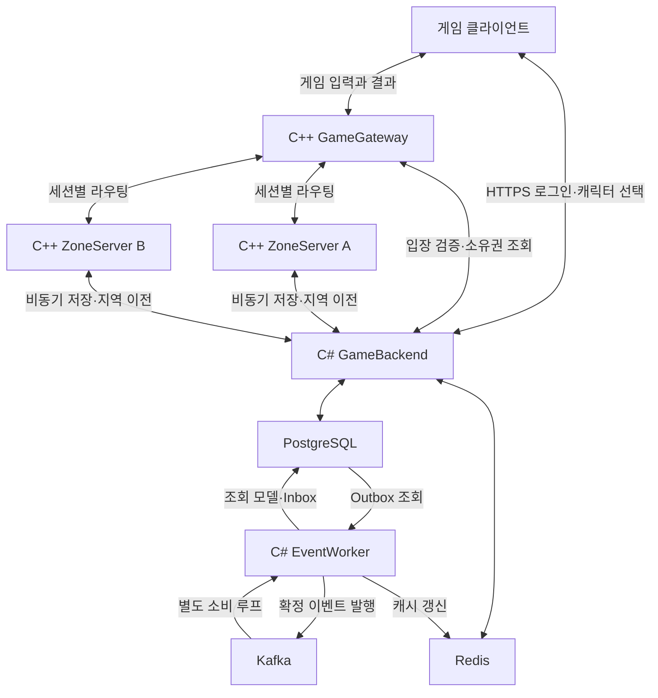
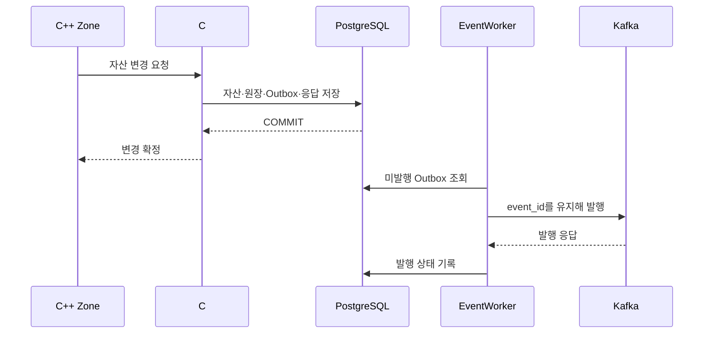

# MMORPG 서버 설계 및 구현 가이드

> 버전: 1.0 · 작성일: 2026-10-08  
> 목적: 미니 PC에서 구현·운영하고, 성능과 정합성을 입증하는 게임 서버  
> 기본 기술: C++ · C#/.NET · PostgreSQL · Redis · Kafka · Kubernetes(K3s)  
> 문서 상태: 구현 전 설계 기준. 구성값과 성능 목표는 초기 제안이며, 실측 결과가 아니다.

## 1. 이 프로젝트가 만드는 것

플레이어들이 같은 지역에서 이동하고 스킬을 사용하며 몬스터와 싸우는 MMORPG 서버를 만든다. 몬스터를 처치해 아이템을 획득하고, 다른 지역으로 이동하며, 접속을 종료했다가 돌아와도 저장된 캐릭터와 자산이 유지되어야 한다.

설계의 중심은 **빠르게 변하는 게임 세계와 영구적으로 보존할 자산을 서로 다른 처리 경로로 관리하는 것**이다.

- **C++ Zone Server**가 위치, 전투, 몬스터 AI를 메모리에서 계산한다.
- **C# GameBackend**가 계정, 캐릭터, 재화, 아이템, 거래의 영구 변경을 처리한다.
- **PostgreSQL**이 영구 상태와 자산 소유권의 기준이다.
- **Redis**는 짧게 유지되는 접속 정보와 재구축 가능한 조회 데이터를 관리한다.
- **Kafka**는 확정된 변경을 업적·통계·조회 모델 등에 전달한다.
- **K3s**는 이 프로그램들을 배포하고 관리한다.

목표는 기술 이름을 많이 나열하는 것이 아니라, 다음 질문에 실행 결과로 답하는 것이다.

1. 두 사람이 같은 아이템을 동시에 주우면 한 명만 얻는가?
2. 저장은 성공했지만 응답이 유실된 요청을 재시도해도 중복 지급되지 않는가?
3. DB나 Kafka가 느려졌을 때 전투 루프가 어떻게 동작하는가?
4. 지역을 이동하는 동안 캐릭터를 두 서버가 동시에 조종하지 않는가?
5. 실제로 이동·전투하는 사용자가 늘어났을 때 어디에서 병목이 생기는가?

### 읽는 순서

| 목적 | 먼저 읽을 부분 |
|---|---|
| 전체 방향 이해 | 2~5절 |
| 이동·스킬·몬스터 구현 | 6~8절 |
| 아이템 중복 방지와 저장 | 9~11절 |
| 이벤트 처리와 Redis | 12~13절 |
| 지역 이동과 장애 복구 | 14~15절 |
| 미니 PC 구축 | 16~18절 |
| 개발 순서 및 검증 | 19~22절 |
| 설계 근거와 참고 자료 | 23절 |

## 2. 전제와 범위

### 2.1 개발 장비

사용자가 제공한 장비 정보를 기준으로 한다.

| 항목 | 사양 및 의미 |
|---|---|
| CPU | Ryzen 7 8845HS, 8코어 / 16스레드 |
| 메모리 | 시스템 출력상 약 28 GiB. 실제 할당은 재설치 후 확인 |
| 저장소 | Crucial P3 Plus 계열 1 TB NVMe, 표시 용량 약 931.51 GiB |
| OS | Rocky Linux 계열 유지 제안. 제공된 현재 설치는 Rocky Linux 9.8 |
| 네트워크 | 현재 유선 링크 1 Gbps. 인터넷 업로드 대역폭은 별도 확인 필요 |
| 물리 장애 영역 | PC 한 대, SSD 한 개 |

이 장비는 개발·시연·제한된 부하 테스트의 시작점이다. 이 구성만으로 특정 동시 접속자 수나 상용 서비스 가용성을 보장하지 않는다.

### 2.2 첫 완성 버전에 포함할 기능

- 계정 인증, 캐릭터 선택, 게임 입장, 재접속.
- 작은 지역 두 개와 지역 간 이동.
- 플레이어 이동, 충돌, 주변 객체 표시.
- 기본 공격, 대상 지정 스킬, 투사체 스킬.
- 몬스터 대기·추적·공격·복귀·사망.
- 드롭 아이템 생성과 획득, 재화 지급, 인벤토리.
- 동일 World 안에서 두 캐릭터 간 간단한 거래.
- Kafka 기반 업적 또는 통계 처리 한 가지.
- Redis 기반 접속 상태와 랭킹 조회.
- 장애 주입, 부하 테스트, 대시보드.

### 2.3 후속 확장 범위

완전한 심리스 월드, 대규모 공성전, 여러 지역에 걸친 실시간 전투, World 간 거래, 글로벌 경매장, 무중단 물리 호스트 장애 복구는 초기 범위에 포함하지 않는다.

첫 버전의 지역 이동은 포털 또는 짧은 로딩 전환으로 구현한다. 이것만으로도 소유권 이전과 장애 복구를 충분히 검증할 수 있다.

## 3. 먼저 알아야 할 용어

| 용어 | 이 문서에서의 의미 |
|---|---|
| World | 캐릭터와 경제가 속하는 논리적 세계. DB 확장 시 중요한 분할 후보 |
| Zone | 한 서버가 시뮬레이션을 담당하는 지역 또는 지역 인스턴스 |
| Gateway | 클라이언트 연결을 유지하고 올바른 Zone으로 메시지를 전달하는 입구 |
| Tick | 일정한 간격으로 게임 상태를 갱신하는 한 번의 처리 |
| 서버 권위 | 이동 가능 여부, 피해량, 아이템 소유권의 최종 판단을 서버가 하는 원칙 |
| AOI | Area of Interest. 플레이어에게 알려줄 주변 객체의 범위 |
| 명령 | “스킬을 사용하겠다”처럼 아직 성공하지 않은 요청 |
| 이벤트 | “아이템 지급이 확정됐다”처럼 이미 발생한 사실 |
| 트랜잭션 | 여러 DB 변경을 함께 성공시키거나 함께 취소하는 단위 |
| 멱등성 | 같은 요청이 여러 번 와도 자산 변경 효과가 한 번만 발생하는 성질 |
| Outbox | 데이터 변경과 같은 트랜잭션으로 기록하는 발행 예정 이벤트 |
| Inbox | 소비자가 이미 처리한 이벤트를 식별하기 위한 기록 |
| Fencing token | 이전 소유자의 늦은 요청을 거부하기 위한 증가하는 소유권 번호 |
| 체크포인트 | 재시작 시 복원할 수 있도록 주기적으로 저장한 상태 |
| 최종적 일관성 | 변경 직후에는 조회 결과가 늦을 수 있지만 이후 기준 상태를 따라가는 방식 |

**World와 Zone은 다르다.** 같은 World의 여러 Zone이 하나의 경제 DB를 사용할 수 있다. 지역이 나뉜다고 DB 트랜잭션까지 반드시 분산되는 것은 아니다.

## 4. 전체 구조



EventWorker 한 프로그램 안에 발행 루프와 여러 소비 루프를 둘 수 있다. 그림의 순환은 같은 이벤트를 무한히 재발행한다는 뜻이 아니다. 소비 결과가 새 이벤트를 만들 때는 별도 이벤트 종류와 발행 규칙을 정한다.

### 4.1 직접 개발할 실행 프로그램

| 프로그램 | 초기 인스턴스 수 | 책임 |
|---|---:|---|
| GameGateway | 1 | 연결, 패킷 프레이밍, 인증된 세션, 라우팅, 유량 제한 |
| ZoneServer | 2 | 지역별 이동·전투·AI·AOI, 저장 요청의 대기 상태 관리 |
| GameBackend | 1 | 인증, 캐릭터, 자산, 거래, 소유권 관리, 운영 API |
| EventWorker | 1 | Outbox 발행, Kafka 소비, 조회 모델·캐시 갱신 |

ZoneServer는 실행 파일 하나를 만들고 `world_id`, `zone_id` 등 설정을 달리해 두 번 실행한다.

GameBackend는 **모듈형 모놀리스**로 시작한다. 인증·인벤토리·거래마다 별도 서비스를 만들지 않고, 코드와 책임을 모듈로 나눈다. 같은 경제 트랜잭션에 참여하는 모듈은 같은 DB 연결과 트랜잭션을 사용한다.

### 4.2 기술 선택 기준

| 기술 | 선택 이유 | 적용 경계 |
|---|---|---|
| C++20, CMake, Asio 계열 | 네트워크·메모리·실시간 루프를 직접 구현하고 측정 | Gateway, Zone |
| C#/.NET 10 LTS, ASP.NET Core | 인증/API/트랜잭션/운영 기능 구현 | Backend, Worker |
| Protobuf | C++와 C#의 메시지 계약 공유 | 게임 메시지와 내부 API 스키마 |
| gRPC | 타입이 있는 내부 요청·응답 | Zone/Gateway와 Backend 간 통신 |
| PostgreSQL | 소유권, 잔액, 거래를 한 트랜잭션으로 검증 | 영구 데이터 |
| Redis | TTL, 짧은 조회, 정렬 집합 | 접속 정보, 티켓, 랭킹 캐시 |
| Kafka | 이벤트 소비 분리, 재시도·재처리 실습 | 확정된 업무 이벤트 |
| K3s | 단일 장비에서 Kubernetes 운용 | 배포, 자원 제한, 재시작 |
| Prometheus, Grafana | 부하와 병목을 수치로 설명 | 메트릭 수집·대시보드 |

.NET 10은 문서 작성 시점의 LTS 선택이다.[S10] 나머지 제품의 정확한 버전과 컨테이너 digest는 구현 시작 시 호환성을 확인해 고정한다. `latest` 태그에 의존하지 않는다. gRPC의 .NET 지원은 공식 문서를 따른다.[S14]

## 5. 데이터의 기준은 어디에 있는가

“데이터를 어디에 저장하는가”와 “누가 그 데이터를 변경할 권한을 갖는가”를 함께 정한다.

| 데이터 | 실행 중 변경 주체 | 영구 저장 및 복구 |
|---|---|---|
| 현재 위치·속도 | 현재 소유 Zone | 주기적 체크포인트 |
| 현재 전투 HP·몬스터 어그로 | Zone | 초기 버전은 재접속·재시작 정책에 따라 복원 또는 초기화 |
| 스킬 시전·투사체 | Zone | 일반적으로 진행 중 동작은 재시작 시 종료 |
| 장기 쿨타임·중요 상태 | Zone 판정 + Backend 저장 | 게임 규칙에 따라 사용 시점 또는 만료 시각 저장 |
| 재화 잔액·아이템 소유권 | Backend | PostgreSQL이 기준 |
| 거래 결과·지급 이력 | Backend | PostgreSQL 트랜잭션과 원장 |
| 캐릭터의 현재 Zone·소유권 번호 | Backend의 WorldDirectory 모듈 | PostgreSQL. Redis에는 조회용 사본 |
| 접속 표시·heartbeat | Gateway/Backend | Redis TTL. 소유권 확정의 근거로 사용하지 않음 |
| 랭킹 조회 | Worker | PostgreSQL 집계가 기준, Redis는 조회용 |
| 분석 이벤트 | Worker | Kafka 보관 기간 및 후속 저장 정책 적용 |

Zone이 가진 인벤토리는 전투 조건을 빠르게 확인하기 위한 사본이다. 아이템 지급·소비·거래를 최종 확정하는 권한은 Backend에 있다.

**늦게 도착한 위치 체크포인트가 최신 인벤토리나 재화를 덮어쓰지 않도록 저장 대상을 분리한다.** 캐릭터 전체를 오래된 JSON 한 덩어리로 교체하는 저장 API를 만들지 않는다.

## 6. 네트워크와 로그인

### 6.1 첫 구현의 통신 방식

| 구간 | 초기 선택 |
|---|---|
| 클라이언트 ↔ Backend | HTTPS |
| 클라이언트 ↔ Gateway | 길이 프리픽스를 가진 TCP + TLS |
| Gateway ↔ Zone | 지속 연결을 통한 내부 메시지 전달 |
| Zone/Gateway ↔ Backend | gRPC 비동기 호출 |
| Backend/Worker ↔ DB | 제한된 연결 풀 |
| Worker ↔ Kafka | Kafka 클라이언트 |

TCP는 초기 개발과 디버깅을 단순하게 하기 위한 선택이다. 패킷 손실에 따른 지연을 측정한 뒤, 이동·스냅샷에 UDP 기반 전송을 도입할지 결정한다. 전송 방식을 바꾸더라도 서버 권위와 메시지 의미는 유지한다.

### 6.2 입장 순서

1. 클라이언트가 Backend에서 로그인하고 캐릭터를 선택한다.
2. Backend가 계정의 캐릭터 소유권을 확인하고 짧은 유효기간의 입장 티켓을 발급한다.
3. 클라이언트가 Gateway에 연결하여 티켓을 제출한다.
4. Gateway가 티켓을 검증하고 소비한다. Redis 사용 시 원자적 소비와 TTL을 적용한다.
5. Backend가 캐릭터의 활성 세션과 Zone 소유권을 확정한다.
6. Zone이 캐릭터·자산·체크포인트를 읽고 입장 준비를 끝낸다.
7. Gateway가 세션을 해당 Zone에 연결한다.
8. 클라이언트가 최초 스냅샷을 받은 뒤 입력을 시작한다.

중복 접속은 초기 버전에서 **기존 활성 세션이 있으면 새 접속을 거절**하는 정책으로 단순화한다. 정상 재접속은 기존 세션을 확인하는 별도 절차로 처리한다.

티켓, 클라이언트가 보낸 `character_id`, Redis의 접속 표시만으로 캐릭터 조종 권한을 확정하지 않는다.

### 6.3 메시지 계약

| 메시지 | 주요 필드 | 서버 검증 |
|---|---|---|
| MoveInput | 입력 순번, 이동 방향, 클라이언트 tick | 순번, 속도 제한, 이동 불가 상태 |
| CastSkill | action_id, 스킬, 대상 또는 방향 | 스킬 보유, MP, 쿨타임, 사거리 |
| PickupItem | request_id, item_instance_id | 대상 존재, 거리, 획득 자격 |
| ChangeZone | request_id, 목적 포털 | 포털 접근 가능 여부 |
| WorldSnapshot | server_tick, 마지막 처리 입력, 객체 변경 | 서버가 생성 |
| CommandResult | request_id, 상태, 변경 버전 | 서버가 생성 |

클라이언트가 보낸 위치·피해량·아이템 수량을 최종 결과로 채택하지 않는다. Gateway가 검증된 세션 정보를 내부 메시지에 붙인다.

패킷 길이 상한, 메시지별 호출 빈도, 연결당 대기 큐 크기를 제한한다. 최초 최대 프레임 크기는 예를 들어 64 KiB로 잡고, 스냅샷이 커지면 분할한다. 이 값은 프로토콜 테스트로 조정한다.

## 7. Zone Server 구현

### 7.1 스레드와 상태 소유권

한 Zone의 변경 가능한 상태는 **하나의 논리적 실행 흐름**이 순서대로 변경한다.

- 네트워크 I/O 스레드는 입력을 해석하고 Zone 큐에 넣는다.
- Zone 루프가 큐를 읽고 플레이어·몬스터 상태를 변경한다.
- 경로 탐색 등 무거운 작업은 작업 풀에서 수행할 수 있다.
- 작업 결과는 다시 Zone 큐로 돌아온다. 작업 스레드가 객체를 직접 변경하지 않는다.
- 비동기 결과에는 객체 세대 번호나 상태 버전을 붙여 이미 사라진 객체에 적용하지 않는다.

플레이어나 몬스터마다 스레드를 만들지 않는다. 여러 Zone 프로세스 또는 Zone 실행 흐름을 여러 코어에 배치해 병렬 처리한다.

### 7.2 Tick

초기 설정 제안은 다음과 같다. 업계 표준값이나 성능 보장이 아니다.

| 작업 | 초기 주기 |
|---|---|
| 이동·전투 시뮬레이션 | 20 Hz, tick당 50 ms |
| 주변 상태 스냅샷 | 10 Hz에서 시작 |
| 몬스터 의사결정 | 5 Hz에서 시작, 개체별 실행 시점 분산 |
| 이동 상태 체크포인트 | 15초 간격에 분산 지연 적용 |
| heartbeat | 5초 간격에서 시작 |

몬스터의 의사결정이 5 Hz여도 결정된 이동과 공격 타이밍은 시뮬레이션 tick에서 진행된다.

```cpp
// 설계 의사코드. 그대로 빌드하는 완성 코드가 아니다.
void Zone::Tick(Duration dt) {
    DrainInputsWithinBudget();
    DrainAsyncCompletionsWithinBudget();
    ValidateAndApplyCommands();
    UpdateMovementAndCollision(dt);
    UpdateScheduledAi();
    UpdateCastsAndProjectiles(dt);
    ApplyDamageBuffsAndDeaths();
    UpdateInterestSets();
    QueueNetworkDeltasIfDue();
    QueueCheckpointsIfDue();
}
```

`Tick` 안에서 DB 호출 결과, gRPC 완료, Kafka 전송 완료를 동기적으로 기다리지 않는다. 요청과 응답 사이에는 `Pending` 상태를 두고 다음 tick들을 계속 수행한다.

과부하 때는 입력을 무한히 쌓거나 뒤처진 tick을 무제한으로 따라잡지 않는다. 입력 처리 예산, 최신 이동 입력 병합, 신규 입장 제한, 비필수 AI 빈도 감소 등의 정책을 적용한다. 경제 명령을 버리면서 성공으로 응답해서는 안 된다.

### 7.3 이동과 동기화

서버는 이동 입력으로 위치를 적분하고 충돌·이동 속도·상태 이상을 검사한다. 시간 계산에는 단조 증가 시계를 사용한다.

클라이언트는 자신의 움직임을 예측하고, 서버가 보낸 위치와 마지막 처리 입력 순번으로 보정한다. 다른 플레이어는 최근 스냅샷 사이를 보간하여 보여준다. 서버 권위와 예측·보정 원칙은 Riot의 공개 설명을 참고한다.[S1]

전체 결정론적 재현은 초기 필수 조건으로 두지 않는다. 대신 입력 순번과 서버 tick을 기록하여 오류를 추적한다.

### 7.4 AOI

첫 구현은 지역을 일정 크기의 셀로 나누는 공간 격자로 시작한다.

1. 객체를 현재 위치의 셀에 등록한다.
2. 플레이어 주변 셀의 객체를 후보로 조회한다.
3. 실제 거리·시야·게임 규칙으로 최종 관심 집합을 계산한다.
4. 이전 관심 집합과 비교해 생성·변경·제거 메시지를 보낸다.

매 tick마다 모든 플레이어와 모든 몬스터 조합을 비교하지 않는다. 단, 좁은 공간에 대부분의 사용자가 모이면 AOI만으로 계산량과 전송량을 해결할 수 없다. 이 경우 별도 밀집 전투 테스트가 필요하다.

## 8. 스킬·몬스터·보상 처리

### 8.1 스킬 사용

1. 입력 순번과 `action_id`로 중복 요청을 검사한다.
2. 생존, 행동 가능 상태, 스킬 보유, MP, 쿨타임을 검사한다.
3. 스킬 유형에 따라 즉시 발동 또는 시전 상태로 전환한다.
4. 발동 시점에 필요한 거리·시야·대상 유효성을 다시 확인한다.
5. 피해량·버프·넉백·사망을 서버에서 계산한다.
6. 관련 플레이어에게 결과를 보낸다.

스킬 정의는 ID, 비용, 시전 시간, 사거리, 판정 방식, 계수, 효과를 데이터로 관리한다. 모든 스킬을 조건문 하나에 추가하는 구조를 피한다. Zone과 Backend가 참조하는 콘텐츠 버전을 함께 고정한다.

몬스터 AI는 `Idle → Chase → Attack`을 기본으로 하고, 대상 이탈 시 `Return`, HP가 0이면 `Dead`로 전환한다. 사망 처리에는 생명주기별 한 번만 실행되는 가드를 둔다.

### 8.2 몬스터 처치와 드롭 생성

몬스터가 죽었다고 매 공격 기록을 DB에 저장할 필요는 없다. 하지만 **영구 보상의 근거가 되는 처치와 드롭은 저장 경계를 가진다.**

1. Zone이 사망과 보상 자격을 결정한다.
2. 몬스터의 이번 생명주기를 식별하는 `spawn_id`와 `kill_id`로 저장 요청을 만든다.
3. Backend가 현재 Zone 권한, 콘텐츠 버전, 중복 여부를 확인한다.
4. 처치 기록, 드롭 아이템, 필요한 보상·Outbox를 같은 트랜잭션에 저장한다.
5. 커밋이 확인되면 드롭을 획득 가능한 상태로 전환한다.
6. 확정 이벤트로 업적·통계를 갱신한다.

사망 연출은 먼저 보일 수 있지만 저장 중인 보상을 이미 확정된 자산으로 표시하지 않는다.

저장 요청이 아직 커밋되지 않은 상태에서 Zone이 사라진 경우, 첫 버전은 해당 미확정 처치의 복원을 보장하지 않는다. 이 한계를 제거하려면 처치 의도를 복구 가능한 로그에 먼저 기록하는 설계가 추가로 필요하다. **커밋된 보상은 Zone 메모리와 무관하게 조회·복구한다.**

### 8.3 물약처럼 영구 아이템을 사용하는 전투

초기 버전은 다음처럼 단순하고 명확한 규칙을 사용한다.

- Zone에서 사용 조건을 확인하고 해당 캐릭터의 소비 동작을 대기 상태로 둔다.
- Backend가 아이템 차감과 소비 결과를 영구 기록한다.
- 성공 응답 후 Zone이 회복 효과를 적용한다. 그동안 다른 플레이어의 tick은 계속 진행한다.
- `action_id`로 차감과 효과의 재적용을 구분한다.

차감 커밋 뒤 Zone이 죽으면 일시적인 회복 연출까지 자동 복구되지는 않는다. 초기 복구 규칙은 안전 지점 재접속과 HP 초기화로 명시한다. 상용 수준에서 소비와 전투 효과를 함께 복구하려면 효과 상태까지 영구 기록하거나 예약·확정·보상 상태 머신을 추가한다.

같은 동작을 재시도했다고 물약을 다시 차감해서는 안 된다.

## 9. PostgreSQL과 데이터 모델

### 9.1 RDBMS를 사용하는 이유

RDBMS가 모든 실시간 변화를 저장해야 한다는 전제부터 제거한다. 초당 여러 번 바뀌는 위치·HP는 Zone에서 계산하고, 실제 자산 변경과 필요한 체크포인트를 저장한다.

PostgreSQL은 아이템 소유권 이전, 잔액 차감, 거래 양쪽의 변경, 지급 이력과 이벤트 기록을 하나의 트랜잭션으로 다루기 위해 선택한다.

MongoDB도 조건부 갱신과 트랜잭션으로 정합성을 구현할 수 있다.[S6] 이 프로젝트에서 제외하는 이유는 성능이 나빠서가 아니라, 이미 PostgreSQL·Redis·Kafka에 명확한 역할이 있어 별도 저장소의 필요성이 아직 없기 때문이다.

NoSQL에 쌓았다가 동일한 쓰기를 전부 PostgreSQL에 옮기면 장기적으로 필요한 PostgreSQL 처리량은 사라지지 않는다. 최종 저장소 처리량보다 입력이 계속 많으면 어느 큐든 계속 늘어난다.

RDS는 DB 종류가 아니라 AWS의 관리형 DB 서비스다. 미니 PC의 첫 구성은 로컬 PostgreSQL이며, 향후 관리형 서비스로 옮길 수 있다.

### 9.2 초기 테이블

| 테이블 | 핵심 내용 |
|---|---|
| accounts | 계정 식별과 인증 정보 |
| characters | World, 캐릭터 기본 정보 |
| character_checkpoints | 위치, 체크포인트 버전, 저장한 소유권 번호 |
| character_ownership | 현재 Zone 인스턴스, owner_epoch, 이전 상태 |
| zone_leases | Zone 프로세스의 유효 임대와 인스턴스 식별자 |
| wallets | 캐릭터·재화 종류별 정수 잔액과 버전 |
| item_instances | 개별 아이템 ID, 소유자, 위치, 슬롯, 버전 |
| inventory_state | 캐릭터별 인벤토리 용량·버전, 직렬화용 행 |
| kill_receipts | 처치 식별자, 보상 규칙 버전, 처리 결과 |
| economy_ledger | 지급·차감·이전 이력 |
| command_results | 요청 식별자, 요청 해시, 확정 응답 |
| outbox_events | 발행할 이벤트, aggregate_seq, 발행 상태 |
| inbox_events | 소비자별 처리한 event_id |
| character_projections | 업적·통계 등 조회 모델 |
| zone_transfers | 지역 이동 식별자, 단계, 출발·도착 소유권 |

주요 규칙:

- 캐릭터 관련 데이터와 인덱스에 `world_id`를 포함한다.
- 재화는 부동소수점 대신 최소 단위의 정수로 저장한다.
- 아이템 종류 ID와 개별 아이템 ID를 구분한다.
- 소유자·슬롯 유일성, 잔액 음수 금지 등을 DB 제약으로도 보호한다.
- 지급 근거의 유일성도 둔다. 새 `request_id`를 만들었다고 같은 처치 보상을 다시 지급할 수 없어야 한다.
- 멱등성 키는 DB의 UNIQUE 제약으로 보호한다. 요청 행 확보는 `INSERT ... ON CONFLICT` 등의 원자적 방식으로 수행하고, 충돌한 요청은 먼저 처리한 트랜잭션의 확정 결과를 확인한다. 사전 SELECT만으로 중복을 판정하지 않는다.
- 원장은 결과를 추적하는 기록이다. 전체 상태를 이벤트로 재구성하는 Event Sourcing을 처음부터 적용하는 것은 아니다.

### 9.3 처리량을 늘리는 순서

1. 불필요한 매 tick 저장을 제거한다.
2. 필요한 인덱스와 실제 실행 계획을 확인한다.
3. 트랜잭션 길이와 연결 풀 크기를 제한한다.
4. 중요도가 낮은 체크포인트를 병합하고 저장 시점을 분산한다.
5. 조회를 캐시·조회 모델로 분리한다.
6. CPU, WAL, 디스크 지연, 잠금 대기를 측정한다.
7. 독립적인 World 단위로 DB를 분리한다.

읽기 복제본을 추가하는 것만으로 단일 primary의 쓰기 병목이 해결되는 것은 아니다.

## 10. 두 유저가 같은 아이템을 획득하면

예시는 바닥에 놓인 **개별 아이템 하나**를 A와 B가 동시에 요청하는 경우다.

### 10.1 Zone에서의 처리

Zone은 거리를 검사한 뒤 해당 아이템을 `PickupPending`으로 예약한다. 다른 요청에는 처리 중임을 알린다. 이 예약은 낭비되는 요청을 줄이지만, 최종 중복 방지 장치는 DB에 둔다.

메모리 예약만으로는 재시작, 중복 요청, 늦은 응답을 모두 방어할 수 없다.

### 10.2 Backend 트랜잭션

다음 작업을 하나의 트랜잭션으로 처리한다.

1. `(world_id, operation_scope, request_id)`의 처리 결과를 확인하거나 요청 행을 확보한다.
2. 같은 ID의 다른 요청 본문이면 거절한다.
3. 현재 소유권과 `owner_epoch`를 검증한다.
4. 캐릭터 인벤토리 행을 잠그고 용량과 획득 자격을 검사한다.
5. 대상 아이템을 조건부로 이전한다.
6. 성공하면 슬롯·원장·Outbox·확정 응답을 기록한다.
7. 커밋 후 성공을 알린다.

핵심 조건부 갱신 예시는 다음과 같다. 전체 트랜잭션이나 완성된 스키마를 대신하는 SQL은 아니다.

```sql
UPDATE item_instances
SET owner_character_id = :character_id,
    location = 'inventory',
    slot_no = :reserved_slot,
    version = version + 1
WHERE world_id = :world_id
  AND item_instance_id = :item_instance_id
  AND location = 'ground'
  AND owner_character_id IS NULL
RETURNING item_instance_id, version;
```

한 요청이 이전을 커밋하면 다른 요청은 조건을 만족하는 행을 얻지 못한다. PostgreSQL Read Committed의 경쟁 UPDATE는 충돌한 변경을 기다린 뒤 변경된 행에 조건을 다시 평가한다.[S2]

- 반환 행 1개: 나머지 저장까지 성공하고 커밋했을 때 획득 확정.
- 반환 행 0개: 이미 획득됐거나 상태가 달라졌으므로 획득 실패.
- 트랜잭션 실패: 성공으로 응답하지 않는다.
- 인벤토리 용량 검사와 슬롯 배정도 같은 트랜잭션에 포함한다.

선착순의 기준은 클라이언트가 표시한 클릭 시각이 아니다. 서버의 유효 요청 처리 순서와 커밋 결과가 기준이다.

### 10.3 응답이 유실되면

`Timeout`은 실패 확정이 아니라 **결과를 모르는 상태**다.

Zone은 같은 `request_id`로 결과를 조회하거나 재시도한다. Backend는 이미 커밋한 결과를 반환한다. 새 ID로 다시 지급을 시도하지 않는다.

알 수 없는 결과가 남아 있는 동안에는 메모리 예약을 임의로 해제해서 같은 자산을 다른 요청에 확정하지 않는다. 상태 조회와 복구 절차로 해소한다.

## 11. 재화와 거래

재화 차감은 읽은 잔액을 애플리케이션에서 빼서 덮어쓰는 대신, 조건을 포함해 갱신한다.

```sql
UPDATE wallets
SET balance = balance - :amount,
    version = version + 1
WHERE world_id = :world_id
  AND character_id = :character_id
  AND currency_type = :currency_type
  AND :amount > 0
  AND balance >= :amount
RETURNING balance, version;
```

이 갱신과 원장·Outbox·요청 결과는 같은 트랜잭션으로 처리한다.

두 캐릭터의 거래는 같은 World의 같은 DB 안에서 수행한다.

- 거래 제안에 거래 ID, 각 참여자의 동의 버전, 제시한 자산을 저장한다.
- 양쪽이 같은 거래 버전에 동의해야 확정할 수 있다.
- 캐릭터와 아이템 잠금은 ID 정렬 등 일관된 순서로 획득한다.
- 양쪽 잔액·아이템 소유권·원장을 한 트랜잭션으로 변경한다.
- 교착이나 일시 오류는 제한된 재시도로 처리하며 동일 요청 ID를 유지한다.
- 거래 중인 아이템은 장착·소비·다른 거래에서 사용할 수 없도록 검증한다.

World 간 거래는 초기 버전에서 금지한다. 나중에 허용하면 여러 저장소에 걸친 예약·보상·복구 정책이 추가로 필요하다.

## 12. 이벤트 드리븐 구조와 Kafka

### 12.1 이벤트를 두 층으로 나눈다

| 구분 | 예 | 전달 방식 |
|---|---|---|
| Zone 내부 이벤트 | 이동 요청, 스킬 발동, 피해 적용 | 메모리 큐와 tick |
| 서비스 간 확정 이벤트 | 아이템 획득 확정, 재화 변경, 처치 기록 확정 | Outbox와 Kafka |

이동 패킷이나 매번의 피해 판정을 Kafka로 보내고 결과를 기다리지 않는다.

이 설계는 이벤트 드리븐 구조지만 모든 상태를 이벤트 로그에서 복원하는 Event Sourcing은 아니다. 명령 처리와 조회 모델을 나누는 CQRS 아이디어도 필요한 부분만 적용한다.

### 12.2 Outbox 발행



DB 커밋과 Kafka 전송을 서로 다른 작업으로 직접 실행하면 둘 중 하나만 성공할 수 있다. Outbox는 업무 데이터와 발행할 이벤트를 같은 DB 트랜잭션에 넣어 이 문제를 다룬다.[S3]

Kafka 전송 성공 후 발행 상태 저장 전에 Worker가 죽으면 같은 이벤트가 다시 발행될 수 있다. 따라서 소비자는 중복을 처리해야 한다.

### 12.3 이벤트 형식

다음은 실제 전송 스키마를 설명하기 위한 JSON 표현이다. 64비트 ID는 JSON 클라이언트의 정밀도 문제를 피하도록 문자열로 표현할 수 있다.

```json
{
  "event_id": "9a9ddf7a-dc0d-4d47-b2da-a0e17c930172",
  "event_type": "InventoryItemAcquired",
  "schema_version": 1,
  "world_id": "1",
  "aggregate_type": "character",
  "aggregate_id": "10001",
  "aggregate_seq": 42,
  "request_id": "2ad1a2e4-5bb2-46ab-a218-03c40154d681",
  "occurred_at": "2026-10-08T08:00:00Z",
  "payload": {
    "item_instance_id": "e1177ea2-54b0-41dc-9065-e5cde430774d",
    "item_template_id": 2001,
    "inventory_version": 17
  }
}
```

### 12.4 Topic과 순서

| Topic | 초기 partition 수 | Key |
|---|---:|---|
| game.character-events.v1 | 3 | world_id + character_id |
| game.world-events.v1 | 3 | world_id + zone_id |
| game.failed-events.v1 | 1 | 원래 aggregate key |

숫자는 단일 PC 실습의 초기값이다. partition 수를 늘린다고 한 캐릭터의 순서 의존 작업까지 병렬화되지는 않는다.

Kafka 순서는 partition 내부의 순서다. 캐릭터별 key를 사용한다고 두 캐릭터가 경쟁하는 아이템의 소유권 문제가 해결되지는 않는다. 그 문제는 10절의 트랜잭션으로 해결한다.

Outbox 조회에서 `ORDER BY id`만 넣는 것으로 업무 순서를 보장하지 않는다. ID 발급 순서와 커밋 순서가 다를 수 있다.

첫 구현은 발행자 하나로 시작하고, aggregate별 이벤트 순번을 업무 트랜잭션에서 할당한다. 같은 aggregate는 앞선 순번의 발행 완료를 확인한 뒤 다음 순번을 발행한다. 발행 커서와 미발행 상태를 영구 기록한다. 발행자를 병렬화할 때는 aggregate별 담당 분할을 추가한다.

### 12.5 소비와 중복 방지

DB를 변경하는 소비자의 순서:

1. DB 트랜잭션을 시작한다.
2. `(consumer_name, event_id)`를 Inbox에 삽입한다.
3. 이미 처리한 이벤트라면 업무 변경을 반복하지 않는다.
4. 새 이벤트라면 조회 모델과 필요한 후속 Outbox를 갱신한다.
5. DB 커밋 후 Kafka offset을 커밋한다.

Kafka offset만 먼저 커밋하면 처리 중 장애에서 이벤트 효과를 잃을 수 있다. Kafka의 exactly-once 기능이 외부 PostgreSQL 변경까지 자동으로 묶어 주는 것도 아니다.[S4]

캐릭터 순서가 필요한 소비자는 partition 안에서 순차 처리하거나 key별 순서를 보장한다. 오류 이벤트를 DLQ로 넘기고 후속 상태 변경을 무조건 계속하지 않는다. 순서 의존 작업은 해당 key를 중단하고 복구하거나, 기준 DB에서 상태를 다시 구성한다.

### 12.6 보관과 재처리

- 첫 개발 설정은 짧은 보관 기간에서 시작하되 실제 디스크 사용량으로 조정한다.
- 시간·용량 제한을 함께 두고, 용량은 전체 partition과 복제본의 합으로 계산한다.
- Kafka 보관 기간이 끝난 이벤트는 임의로 다시 읽을 수 없다.
- 장기 재처리는 보존한 원장·Outbox·별도 아카이브 정책이 있어야 한다.
- 기존 Inbox를 유지하면 재소비 시 이미 처리한 효과는 건너뛴다.
- 조회 모델 전체 재구축은 새로운 소비자 이름과 별도 대상 테이블에서 수행한 뒤 교체한다.

## 13. Redis의 역할

| Key 예시 | 내용 | 소실 시 처리 |
|---|---|---|
| ticket:{ticket_id} | 짧은 입장 티켓 | 다시 발급 |
| presence:{character_id} | 접속 표시와 TTL | heartbeat 또는 재접속으로 복원 |
| route:{world_id}:{character_id} | Zone 조회 캐시 | Backend의 기준 정보 재조회 |
| ranking:{world_id}:{season_id} | 랭킹 Sorted Set | PostgreSQL 집계로 재구축 |

Redis를 잃어도 확정된 재화·아이템이 사라지는 구조로 만들지 않는다. Redis Pub/Sub는 연결이 끊긴 소비자에게 메시지를 다시 전달하는 내구성 큐가 아니므로, 반드시 처리해야 하는 자산 이벤트에 사용하지 않는다.[S7]

초기에는 Redis 한 인스턴스를 사용하되 `maxmemory`와 정책을 명시한다. 티켓과 조회 캐시를 섞으면 eviction으로 티켓까지 사라질 수 있다. 초기에는 `noeviction`과 쓰기 실패 처리를 사용하고, 메모리 압박이 관찰되면 캐시와 세션 용도를 인스턴스로 분리한다.[S15]

랭킹에는 가능하면 “점수 10 증가”보다 **기준 점수와 버전을 절대값으로 적용**한다. 오래된 버전으로 최신 결과를 덮어쓰지 않는다.

PostgreSQL의 Inbox 기록과 Redis 갱신은 하나의 트랜잭션이 아니다. Inbox가 있다고 Redis 갱신까지 성공했다고 간주하지 않는다. 초기 구현은 DB 조회 모델을 먼저 확정하고, 캐시 갱신 실패를 재시도하며 주기적으로 DB와 대사한다. 전체 캐시 삭제 후 재구축도 검증한다.

## 14. Zone 이동과 소유권 이전

### 14.1 기본 원칙

캐릭터를 변경할 수 있는 Zone은 한 시점에 하나다. 다음 정보를 Backend의 기준 저장소에서 관리한다.

- `world_id`, `character_id`
- 현재 `zone_instance_id`
- 증가하는 `owner_epoch`
- `Active` 또는 `Transferring` 상태
- 진행 중인 `transfer_id`

Zone 프로세스가 재시작하면 새로운 `zone_instance_id`를 받는다. 같은 Pod 이름이라고 같은 프로세스 세대로 간주하지 않는다.

### 14.2 이동 절차

1. 출발 Zone이 포털 조건을 검증하고 캐릭터의 새 입력을 잠시 중단한다.
2. 진행 중인 경제 명령의 결과를 해소하고 상태 스냅샷을 만든다.
3. Backend가 현재 owner_epoch를 확인해 이전 기록을 생성한다.
4. 도착 Zone이 스냅샷을 읽고 준비한다. 아직 시뮬레이션 권한은 없다.
5. Backend가 조건부 트랜잭션으로 소유 Zone을 변경하고 owner_epoch를 증가시킨다.
6. Gateway가 새 소유권으로 라우팅을 바꾼다.
7. 도착 Zone이 새 epoch로 캐릭터를 활성화한다.
8. 출발 Zone이 이전 객체를 제거한다.

재시도는 같은 transfer_id를 사용한다. 상태를 단순히 되돌리기보다 기준 DB의 현재 소유자를 확인하여 다음 단계를 진행한다.

### 14.3 Fencing과 lease

모든 중요한 저장 요청에는 owner_epoch와 zone_instance_id를 포함한다. Backend는 검증과 업무 변경을 같은 트랜잭션 경계에서 처리하여 이전 소유자의 늦은 저장을 거부한다. 소유권 이전과 경제 명령이 경쟁해도 검증 뒤 권한이 바뀌는 틈이 없도록 잠금 순서를 정한다.

체크포인트도 owner_epoch와 checkpoint_version을 비교한다. 이전 Zone이 늦게 보낸 저장이 최신 위치를 덮어쓰면 안 된다.

Zone은 Backend가 관리하는 lease를 주기적으로 갱신한다. 초기 heartbeat 5초·lease 15초는 테스트용 제안이다. 갱신을 확인하지 못하면 보수적인 만료 시점에 권위 있는 처리를 중단하고 연결을 종료한다. Gateway도 만료된 경로에서 오는 메시지를 계속 전달하지 않는다.

DB의 fencing만으로 이전 Zone의 화면 전송까지 멈추지는 않는다. Gateway의 epoch 검사, Zone의 만료 처리, 도착 Zone의 활성화 조건을 함께 구현한다.

재시도·만료·도착 Zone 장애를 포함한 이전 상태 머신이 검증되기 전에는 자동 장애 전환을 켜지 않는다.

## 15. 장애와 복구 정책

| 장애 | 기본 동작 | 복구 기준 |
|---|---|---|
| Zone 종료 | 연결 재설정, 해당 지역의 시뮬레이션 중단 | 새 소유권 확보 후 체크포인트와 영구 자산 복원 |
| Gateway 종료 | 해당 연결 끊김 | 재인증·재접속. Zone의 세션 유예 정책 적용 |
| Backend 일시 지연 | 경제 명령을 제한된 수만 대기 | 동일 ID로 결과 확인, 큐 초과 시 명확히 거절 |
| PostgreSQL 중단 | 자산 확정·지역 이전·신규 소유권 부여 중지 | 복구 후 결과 조회. lease 만료 시 Zone도 중단 |
| Kafka 중단 | 기존 전투·경제 커밋은 잠시 지속 가능 | Outbox 재발행. 적체 한도 도달 시 입장·보상 생산 제한 |
| Redis 중단 | 티켓·캐시 기능 저하 | 기준 DB 재조회와 캐시 재구축 |
| Worker 종료 | 업적·랭킹 반영 지연 | 재시작 후 미발행·미처리 이벤트 재처리 |
| SSD 또는 PC 고장 | 전체 서비스 중단 | 장비 외부 백업에서 복원 |

DB가 없어도 게임을 무제한 진행시키지 않는다. 특히 lease, 보상 대기, Outbox 용량의 한도에 도달하면 기능을 제한한다.

### 15.1 어떤 데이터가 얼마나 복구되는가

- **커밋된 자산:** 정상적인 DB 내구성 설정과 저장 장치가 유지되는 프로세스 장애에서는 복구 대상으로 삼는다.
- **이동 상태:** 마지막으로 성공한 체크포인트까지 복원한다. 저장 지연 중에는 설정한 15초보다 복원 간격이 커질 수 있다.
- **진행 중 전투:** 첫 버전에서는 안전 지점 재입장, 일반 몬스터 초기화 정책을 사용한다.
- **장비 전체 손실:** 외부 백업과 WAL 보관 수준에 따라 데이터 손실 범위가 달라진다.

중요 자산 트랜잭션에는 `synchronous_commit=on`, `fsync=on` 등 내구성 설정을 유지한다. 비동기 커밋은 장애 시 최근 성공 응답된 변경이 사라질 수 있다는 별도 의미를 갖는다.[S13] SQL 커밋만으로 SSD 물리 고장이나 손실된 백업까지 해결되지는 않는다.

## 16. K3s 배포

### 16.1 첫 배치

단일 K3s 노드에서 시작한다. 처음부터 서비스 메시나 분산 스토리지 운영까지 추가하지 않는다.

| 구성 | 초기 배포 |
|---|---|
| Gateway | Deployment 1개 |
| Zone A, Zone B | Zone별 Deployment, replicas 1, 초기 Recreate 전략 |
| Backend | Deployment 1개 |
| Worker | Deployment 1개. 발행자는 논리적으로 하나만 활성 |
| PostgreSQL | StatefulSet 1개와 전용 PVC |
| Redis | Deployment 1개. 재구축 가능한 데이터만 저장 |
| Kafka | KRaft broker/controller 겸용 1개와 PVC |
| 모니터링 | Prometheus, Grafana의 제한된 구성 |

StatefulSet이나 replicas 1만으로 중복 프로세스 방지가 완성되지는 않는다. Zone의 owner_epoch와 lease 검증을 계속 사용한다.

Kafka의 broker/controller 겸용 모드는 소규모 개발 환경용 시작점이다. 공식 문서도 중요한 운영 환경에서는 역할 분리를 권고한다.[S5] 로컬 설정은 replication factor 1, min ISR 1이며 내구성 복제가 없다. 내부 topic 복제 계수도 단일 broker에 맞춰야 한다.

### 16.2 네트워크와 노출

- Backend HTTPS와 Gateway 게임 포트만 외부에 노출한다.
- PostgreSQL, Redis, Kafka, Zone 내부 포트는 내부 통신에 사용한다.
- 일반적인 HTTP Ingress 설정으로 raw TCP 게임 프로토콜이 자동 노출되지는 않는다.
- 개발 초기 Gateway는 NodePort 등 명시적인 L4 노출 방식으로 연결한다.
- 노드 추가 후에도 Gateway가 특정 캐릭터의 소유 Zone을 찾아야 한다. Zone 전체에 무작위 부하 분산하지 않는다.
- Namespace는 `game`, `data`, `observability` 정도로 시작한다.

### 16.3 종료와 배포

Zone 종료 시 새 입장을 막고, 기존 캐릭터를 안전 지점으로 저장하거나 다른 Zone으로 이전한 뒤 종료한다. `preStop`과 종료 유예 시간을 두되 강제 종료에도 복구 가능해야 한다.

readiness는 새 입장 가능 상태를 반영한다. liveness는 DB의 짧은 지연만으로 연쇄 재시작을 일으키지 않도록 설정한다.

첫 Zone 배포는 짧은 점검을 허용한다. 상태 이전이 완성되기 전부터 무중단 롤링 배포를 목표로 삼지 않는다.

HPA가 Pod 수를 늘려도 기존 Zone 내부의 플레이어와 AI를 자동으로 분할하지 않는다. 새 Zone 할당과 캐릭터 이전은 애플리케이션 책임이다.

## 17. 메모리와 디스크 계획

### 17.1 메모리

다음은 약 28 GiB 장비의 **계획용 예산**이며, Kubernetes requests/limits 최종값이나 실측 사용량이 아니다.

| 영역 | 초기 예산 |
|---|---:|
| OS, K3s, 기본 시스템 | 4 GiB |
| Gateway | 0.5 GiB |
| Zone 두 개 합계 | 4 GiB |
| Backend | 1.5 GiB |
| Worker | 1 GiB |
| PostgreSQL | 3 GiB |
| Kafka | 3 GiB |
| Redis | 0.5 GiB |
| Prometheus, Grafana | 1.5 GiB |
| 합계 | 19 GiB |

나머지는 파일 캐시, 순간 증가, 빌드·운영 작업의 여유로 남긴다. 모든 잔여 메모리를 Pod limit으로 미리 배정하지 않는다.

Kafka 예산은 JVM heap만 의미하지 않는다. PostgreSQL도 shared_buffers 외에 연결·쿼리 작업 메모리를 사용한다. Redis maxmemory도 프로세스 전체 메모리와 같지 않다.

Zone CPU limit을 과도하게 낮추면 스로틀링으로 tick 지연이 생길 수 있다. CPU request와 실제 사용률을 먼저 측정하고 limit 정책을 정한다. 16개 논리 스레드를 16개 독립 물리 코어처럼 계산하지 않는다.

### 17.2 Linux 재설치 시 파티션 제안

단일 NVMe에 GPT를 사용하고, EFI와 /boot 외의 데이터는 LVM으로 관리한다.

| 마운트 위치 | 크기 | 파일시스템 | 용도 |
|---|---:|---|---|
| /boot/efi | 1 GiB | FAT32 | UEFI |
| /boot | 2 GiB | ext4 | 부팅 파일 |
| / | 96 GiB | XFS | OS와 기본 패키지 |
| /home | 128 GiB | XFS | 코드·개발 데이터 |
| /var/lib/rancher/k3s | 96 GiB | XFS | K3s 상태·이미지·런타임 |
| /srv/pv/postgres | 160 GiB | XFS | PostgreSQL 데이터와 WAL |
| /srv/pv/kafka | 128 GiB | XFS | Kafka 로그 |
| /srv/pv/observability | 32 GiB | XFS | 메트릭 데이터 |
| LVM 미할당 | 약 288.5 GiB | 미할당 | 실제 증가량에 따라 확장 |

합계 할당은 643 GiB이며, 나머지는 931.51 GiB 표시 용량 기준의 근사치다. 정렬과 LVM 메타데이터로 실제 크기는 조금 달라진다.

이번 기준 구성에는 MongoDB 전용 파티션을 만들지 않는다. 향후 필요하면 LVM 여유에서 배정한다. 별도 swap 파티션은 기본안에서 생략하고, 도입 시 사용하는 K3s/Kubernetes의 swap 정책을 확인한다.

장치 전체를 다시 나누는 작업은 데이터 삭제를 수반하므로 재설치 전에 외부 백업과 복원 확인을 완료한다. 이 문서는 파티션 설계이며, 포맷 명령을 실행하지 않는다.

### 17.3 경로와 볼륨 연결

K3s의 기본 local-path 볼륨은 `/var/lib/rancher/k3s/storage` 아래에 만들어진다.[S8] 디렉터리를 따로 만들기만 해서는 DB가 그곳을 쓰지 않는다.

PostgreSQL·Kafka·모니터링에는 전용 경로를 가리키는 static local PV/PVC를 명시한다. local PV의 node affinity를 설정하고, 중요한 데이터는 `Retain` 정책으로 관리한다.[S12]

Rocky Linux의 SELinux를 유지할 경우 적절한 정책·레이블과 컨테이너 쓰기 권한을 확인한다. K3s 공식 문서상 SELinux에서 임의의 `--data-dir` 변경은 기본 지원 경로가 아니다.[S9] 따라서 기본 경로에 별도 LV를 마운트하는 방식을 제안한다.

서비스 시작 전에 해당 마운트가 준비되도록 의존성을 설정한다. 마운트 실패 때 루트 파일시스템의 빈 디렉터리에 DB가 새로 생성되는 일을 방지한다.

XFS 확장 방식에 맞춰 필요한 LV를 늘린다.[S11] 용량을 크게 선할당한 뒤 쉽게 줄일 수 있다는 전제로 계획하지 않는다.

서로 다른 파티션도 같은 SSD의 I/O를 공유한다. 용량 격리가 물리적인 성능 격리나 백업을 의미하지 않는다.

## 18. 운영과 보안의 기본 구현

| 영역 | 구현 기준 |
|---|---|
| 인증 | 검증된 인증 라이브러리의 비밀번호 해시·토큰 처리 사용 |
| 내부 API | 호출 서비스의 신원과 허용 작업 검증. 내부 IP만으로 신뢰하지 않음 |
| 권한 | 클라이언트는 자산 지급 API를 직접 호출하지 못함 |
| 비밀 값 | 저장소에 넣지 않고 Secret 등으로 주입. 접근 권한과 저장 암호화 별도 설정 |
| 입력 | 크기·빈도·범위 검사, 서버 시간·위치·콘텐츠 규칙 검증 |
| 로그 | 토큰·비밀번호를 기록하지 않음. request_id, event_id, owner_epoch는 추적에 활용 |
| DB | 역할별 최소 권한, 연결 제한, migration 전용 절차 |
| 백업 | PC 외부에 DB 백업, 필요 시 WAL 보관. 복원 테스트 포함 |
| 배포 | 프로토콜과 DB 변경에 이전 버전 호환 기간 확보 |

운영 API에는 아이템 지급, 계정 제재, 이벤트 재처리 등 중요한 작업의 실행자와 사유를 기록한다.

게임 자산 복구의 기준은 PostgreSQL 백업이다. K3s 상태 백업만으로 PostgreSQL 내용이 함께 백업되는 것은 아니다. 같은 NVMe의 다른 파티션에만 둔 백업은 장비 손실을 방어하지 못한다.

## 19. 저장소와 코드 구성

모노레포 한 개로 시작한다. 다음은 만들 디렉터리의 역할이며, 이 문서와 함께 소스 코드가 생성되었다는 뜻은 아니다.

| 경로 | 내용 |
|---|---|
| contracts/game/ | 게임 Protobuf 메시지 |
| contracts/backend/ | 내부 gRPC 계약 |
| contracts/events/ | Kafka 이벤트 스키마 |
| server/cpp/gateway/ | 연결·세션·라우팅 |
| server/cpp/zone/ | tick·이동·전투·AI·AOI |
| server/cpp/common/ | 공통 네트워크·메시지·계측 |
| server/dotnet/GameBackend/ | ASP.NET Core 실행 프로그램 |
| server/dotnet/Modules/ | Auth, Characters, Economy, WorldDirectory 등 |
| server/dotnet/EventWorker/ | Outbox·소비자·캐시 갱신 |
| database/migrations/ | 스키마 변경 |
| game-data/ | 맵·스킬·아이템·몬스터 정의 |
| deploy/k3s/ | 서비스·볼륨·설정·리소스 배포 |
| observability/ | 대시보드·알림 |
| tests/integration/ | 실제 DB·메시지 브로커 정합성 검증 |
| tools/loadgen/ | 실제 게임 프로토콜을 사용하는 봇 |
| docs/ | 설계 결정, 운영 절차, 측정 보고서 |

Backend의 경제 모듈은 “요청 검증 → 트랜잭션 → 결과” 흐름을 갖는다. DB 호출을 Controller 여기저기에 흩어놓지 않는다.

C++의 전투·이동 계산은 네트워크와 분리하여 같은 입력과 시간 조건으로 검증할 수 있게 만든다. 공통 계약은 생성 코드로 공유하고 C++와 C#에 필드를 수동 복제하지 않는다.

## 20. 구현 순서와 완료 조건

| 단계 | 구현 내용 | 완료 조건 |
|---|---|---|
| 1. 실행 기반 | 빌드 환경, 컨테이너, K3s, PG, 로그·메트릭 | 재부팅 후 서비스와 볼륨이 정상 연결 |
| 2. 접속 | Backend 로그인, Gateway, Zone 하나 | 두 클라이언트가 같은 지역 입장 |
| 3. 이동 | tick, 입력 순번, 이동·충돌, AOI | 서로의 움직임과 시야 진입·이탈 확인 |
| 4. 전투 | 스킬, 몬스터 AI, 피해·사망 | 클라이언트 간 결과 일치, 부정 입력 거절 |
| 5. 영구 자산 | 드롭, 인벤토리, 재화, 원장·멱등성 | 동시 획득·재시도·응답 유실 검증 |
| 6. 이벤트 | Outbox, Kafka, Inbox, 업적 | Worker 강제 종료 후 누락 없이 복구 |
| 7. Redis | 티켓, presence, 랭킹 캐시 | Redis 초기화 후 재구축, 자산 영향 없음 |
| 8. 두 번째 Zone | 이전 상태 머신, fencing | 이전 중 장애에서도 활성 소유자 하나 |
| 9. 거래 | 거래 동의 버전, 원자적 이전 | 양쪽 자산 보존, 중복 확정 방지 |
| 10. 운영 검증 | 부하·장애 테스트, 백업 복원 | 측정 결과와 재현 방법을 문서화 |

Kafka와 Redis를 최종 구성에 포함하되, 전투와 자산 정합성이 동작한 후 기능을 연결한다. 기반 시스템을 한꺼번에 만들면서 원인을 알 수 없는 오류를 늘리지 않는다.

첫 번째 세로 단면은 **로그인 → 같은 지역 이동 → 몬스터 처치 → 아이템 획득 → 재접속 후 보유 확인**이다. 이 흐름이 실행된 뒤 범위를 넓힌다.

## 21. 검증 시나리오와 관측 지표

### 21.1 반드시 통과할 정합성 테스트

| 테스트 | 주입 조건 | 기대 결과 |
|---|---|---|
| 동시 획득 | 두 요청이 같은 개별 아이템을 경쟁 | 최종 소유자 한 명 |
| 재화 동시 차감 | 잔액보다 큰 합계의 요청 | 음수 잔액 없음 |
| 요청 중복 | 동일 request_id를 반복 전달 | 자산 효과 한 번 |
| ID 오용 | 같은 request_id, 다른 본문 | 거절 |
| 응답 유실 | 커밋 직후 연결 종료 | 재조회로 기존 결과 확인 |
| 발행 중 종료 | Kafka ack 후 Outbox 표시 전 종료 | 이벤트 중복 가능, 소비 효과는 한 번 |
| 소비 중 종료 | DB commit 후 offset commit 전 종료 | Inbox로 업무 변경 중복 방지 |
| 이전 지연 | 이전 Zone의 늦은 저장 전달 | 낮은 owner_epoch 거절 |
| 도착 실패 | 소유권 이전 전후 도착 Zone 종료 | 상태 머신에 따라 한 소유자로 복구 |
| Redis 삭제 | 캐시 전체 초기화 | 자산 유지, 조회 모델로 캐시 복구 |
| PG 중단 | 거래 중 DB 접근 차단 | 성공을 가장하지 않음, 결과 재조회 |
| 백업 복원 | 새 DB에 외부 백업 복원 | 자산·원장·미발행 이벤트 대사 |

테스트는 HTTP 응답 코드만 확인하지 않는다. 아이템 소유자 수, 잔액, 원장 효과, 이벤트·Inbox 상태를 함께 검사한다.

### 21.2 부하 테스트

접속만 유지하는 봇과 실제 전투하는 봇을 구분한다.

- 분산 이동: 여러 AOI에 플레이어를 분산한다.
- 밀집 전투: 한 AOI에 모여 스킬·AI·투사체를 실행한다.
- 경제 집중: 획득·거래 요청을 늘린다.
- 장애 동반: Kafka 정지, DB 지연, Zone 재시작을 함께 적용한다.

초기에는 50 → 100 → 200 등 작은 단계로 부하를 늘리되, 수치는 목표 성능 보장이 아니다. 가능하면 부하 생성기는 다른 장비에서 실행한다. 같은 PC에서 돌리면 봇 CPU·메모리도 사용량에 포함해 보고한다.

### 21.3 지표

| 영역 | 주요 지표 |
|---|---|
| Zone | tick 처리 시간 p50/p95/p99, 50 ms 초과 비율, 큐 길이, 객체 수 |
| 네트워크 | 입력→결과 지연, RTT, 세션당 송신량, 전송 큐 적체 |
| AOI | 플레이어당 관심 객체 수, 생성·제거 메시지 수 |
| Backend | 경제 명령 지연, 성공·거절·미확정 비율, 연결 풀 대기 |
| PostgreSQL | 트랜잭션 지연, 잠금 대기, WAL 증가량, 디스크 지연 |
| 이벤트 | 가장 오래된 미발행 Outbox 나이, consumer lag, 재시도·DLQ 수 |
| 호스트 | CPU 스로틀링, 메모리, SSD 여유·지연, 온도 |

20 Hz에서 50 ms는 tick 간격이다. 매 tick이 49 ms를 쓰는 상태를 여유 있는 상태로 평가하지 않는다. 예를 들어 p99 처리 시간 30 ms 이내를 첫 실험 목표로 둘 수 있지만, 이는 검증 전의 목표다.

접속자 수만 보고하지 않고 맵 크기, 밀집도, 몬스터 수, 스킬 빈도, 패킷 크기, 테스트 지속 시간, DB 내구성 설정을 함께 남긴다.

## 22. 확장 방향과 설계 변경 조건

| 관찰한 병목 | 우선 대응 |
|---|---|
| Zone CPU | AI·충돌·AOI 프로파일링, 공간 분할, 지역/인스턴스 분리 |
| 특정 밀집 지역 | 별도 고밀도 설계·수용 인원 정책. Pod 복제만으로 해결 불가 |
| Gateway 송신 | AOI·delta 전송·메시지 크기 최적화, Gateway 수평 확장 |
| Backend CPU | 무상태 인스턴스 추가, 단 DB 연결 수 총량 제한 |
| PG 잠금 | 짧은 트랜잭션, 잠금 순서, hot row 제거 |
| PG 쓰기·I/O | 저장 빈도·인덱스 재검토, 전용 장비, World별 분리 |
| Kafka 적체 | 원인 소비자 최적화, 독립 key 기준 partition·소비자 확장 |
| Redis 메모리 | TTL·크기 조정, 용도 분리, 조회 모델 범위 제한 |
| 같은 SSD의 I/O 경쟁 | 데이터 저장 장비 분리 |

물리 노드가 늘어나면 게임 서버, DB, Kafka를 서로 다른 장애 영역으로 배치한다. PostgreSQL 복제·백업·장애 전환, Kafka 다중 broker와 controller, 적절한 복제 계수와 ISR 정책을 별도로 설계한다.

MongoDB나 다른 저장소는 구체적인 조회 패턴·보관량·정합성 요구가 생겼을 때 검토한다. 검색, 대규모 분석, 비정형 문서 저장에는 각각 다른 저장소가 적합할 수 있다. “유저가 많아졌다”만으로 교체하지 않는다.

### 이 프로젝트에서 보여줄 결과물

- 이 설계 문서와 변경 사유를 기록한 ADR.
- 두 클라이언트의 이동·전투·획득·지역 이동 시연.
- 중복 획득과 재시도 검증 결과.
- Kafka·Zone 장애 후 복구 시연.
- 동일 시나리오의 최적화 전후 그래프.
- 장비 사양, 설정, 실행 명령, 원본 측정값이 포함된 성능 보고서.
- 백업에서 새 환경으로 복원한 기록.

구현이 끝나면 이 문서의 “제안”과 “목표”를 실제 선택값과 측정 결과로 갱신한다.

## 23. 공개 사례와 참고 자료

다음 자료는 원칙과 제품 동작의 근거다. 이 문서의 구성·주기·예산·스키마는 해당 기업의 시스템을 복제한 것이 아니라, 이 프로젝트의 제약에 맞춘 설계 제안이다. 링크 확인 기준일은 2026-10-08이다.

### 23.1 대규모 프로젝트에서 참고한 원칙

- **Riot VALORANT:** 서버 권위, 클라이언트 예측·보정 원칙을 참고한다. FPS의 tick 수치를 MMORPG에 그대로 적용하지 않는다.[S1]
- **Amazon New World:** 공개된 2022년 구조는 접속 진입점과 지역 시뮬레이션을 나누고, 이동에 따라 상태를 이전하며 DynamoDB에 상태를 저장한다. 여기서 참고하는 것은 책임 분리와 지역별 계산 분산이다. PostgreSQL만이 MMO의 정답이라는 근거로 사용하지 않는다.[S16]

공개 사례의 일부만으로 현재 운영 구조 전체를 알 수는 없다. 특정 서비스의 규모를 이 미니 PC의 처리 가능 인원으로 환산하지 않는다.

### 23.2 자료 목록

| ID | 공식 자료 | 사용한 내용 |
|---|---|---|
| S1 | [Riot — Peeking into VALORANT's Netcode](https://www.riotgames.com/en/news/peeking-valorants-netcode) | 서버 권위, 이동 예측과 보정 |
| S2 | [PostgreSQL — Transaction Isolation](https://www.postgresql.org/docs/current/transaction-iso.html) | Read Committed의 경쟁 갱신 |
| S3 | [AWS — Transactional outbox pattern](https://docs.aws.amazon.com/prescriptive-guidance/latest/cloud-design-patterns/transactional-outbox.html) | DB 변경과 이벤트 기록, 중복 처리 |
| S4 | [Apache Kafka — Design](https://kafka.apache.org/43/design/design/) | partition 순서와 전달 보장, 외부 저장소 연계 |
| S5 | [Apache Kafka — KRaft](https://kafka.apache.org/43/operations/kraft/) | broker/controller 역할과 개발용 겸용 모드 |
| S6 | [MongoDB — Atomicity and Transactions](https://www.mongodb.com/docs/manual/core/write-operations-atomicity/) | 조건부 원자적 갱신과 트랜잭션 |
| S7 | [Redis — Pub/Sub](https://redis.io/docs/latest/develop/pubsub/) | Pub/Sub 전달 특성 |
| S8 | [K3s — Volumes and Storage](https://docs.k3s.io/add-ons/storage) | 기본 저장 경로와 노드 종속성 |
| S9 | [K3s — Advanced Options](https://docs.k3s.io/advanced) | SELinux와 data-dir 제약 |
| S10 | [.NET — Support Policy](https://dotnet.microsoft.com/en-us/platform/support/policy/dotnet-core) | .NET 10 LTS |
| S11 | [Red Hat — Increasing the size of an XFS file system](https://docs.redhat.com/en/documentation/red_hat_enterprise_linux/9/html/managing_file_systems/increasing-the-size-of-an-xfs-file-system_managing-file-systems) | XFS 확장 |
| S12 | [Kubernetes — Volumes](https://kubernetes.io/docs/concepts/storage/volumes/#local) | local volume과 node affinity |
| S13 | [PostgreSQL — Asynchronous Commit](https://www.postgresql.org/docs/current/wal-async-commit.html) | 커밋 내구성 정책 |
| S14 | [Microsoft — gRPC on .NET](https://learn.microsoft.com/en-us/aspnet/core/grpc/?view=aspnetcore-10.0) | .NET의 gRPC 구현 |
| S15 | [Redis — Key eviction](https://redis.io/docs/latest/develop/reference/eviction/) | 메모리 제한과 eviction 정책 |
| S16 | [AWS — The Unique Architecture behind Amazon Games' Seamless MMO New World](https://aws.amazon.com/blogs/gametech/the-unique-architecture-behind-amazon-games-seamless-mmo-new-world/) | 진입점·지역 시뮬레이션 분리와 상태 저장 |

## 부록 A. 구현 전 확정할 세부 규칙

다음 항목은 구조를 뒤집는 미정 사항이 아니라, 게임 규칙과 테스트를 통해 구체화할 설정이다.

| 항목 | 초기 기준 |
|---|---|
| 전투 방식 | 단순 PvE, 서버 판정. 초기 20 Hz |
| 접속 중복 | 새 접속 거절, 재접속은 별도 검증 |
| 일반 전투 재시작 | 안전 지점 복원, 진행 중 시전 종료 |
| 장기 쿨타임 | 절대 만료 시각 등 별도 영구 저장 정책 |
| 드롭 자격 | 처치 기여·파티 규칙을 서버에서 결정 |
| 드롭 소멸 | 만료 상태도 조건부 갱신하여 획득과 경쟁 처리 |
| 아이템 스택 | 초기 비스택 아이템으로 경합 검증 후 수량·분할 추가 |
| 트랜잭션 잠금 | 소유권·캐릭터·아이템의 일관된 획득 순서 |
| 요청 기록 보관 | 재시도·이벤트 재처리 기간 이상. 지급 근거 유일성은 별도 유지 |
| 메시지 호환성 | 필드 번호 재사용 금지, 이벤트 schema_version 관리 |
| 디스크 한도 | Kafka·Outbox·메트릭 증가량에 따른 명시적 상한 |
| 운영 목표 | 측정 전 CCU 보장 없음. 실험 조건과 병목을 공개 |

## 부록 B. 설계에서 지켜야 할 불변 조건

1. 하나의 개별 아이템에는 동시에 두 소유자가 존재하지 않는다.
2. 정상적인 재화 차감으로 잔액이 음수가 되지 않는다.
3. 같은 지급 근거로 동일 보상을 중복 확정하지 않는다.
4. 클라이언트는 최종 피해량과 자산 변경량을 결정하지 않는다.
5. 낮은 owner_epoch의 중요한 저장은 최신 상태를 덮어쓰지 않는다.
6. 경제 변경과 그 Outbox 기록은 함께 커밋된다.
7. 이벤트 재전달이 영구 업무 효과를 중복 적용하지 않는다.
8. Redis의 소실이 영구 자산의 소실로 이어지지 않는다.
9. 미확정 작업을 확정 성공으로 응답하지 않는다.
10. 모든 대기 큐와 저장소 적체에는 관측 지표와 한도가 있다.

