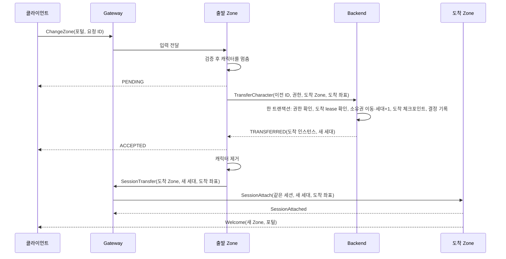

# 10 두 번째 Zone: 소유권을 옮기고 낡은 소유자를 막는다

## 배경

이 프로젝트의 지역 서버(Zone, C++)는 한 지도를 20 Hz 틱으로 시뮬레이션하는 프로세스다. 계정·캐릭터·자산은 Backend(.NET)가 PostgreSQL 트랜잭션으로 확정하고, 클라이언트는 Gateway(C++)를 거쳐 Zone에 닿는다. 캐릭터를 바꿀 수 있는 Zone은 한 시점에 하나여야 한다. Backend의 소유권 행(`character_ownership`)이 "어느 Zone 인스턴스가, 몇 번째 세대(`owner_epoch`)로" 그 캐릭터를 맡는지 적고, Zone이 Backend에 보내는 모든 저장 요청은 그 두 값을 권한으로 들고 온다. Zone은 Backend lease를 주기적으로 갱신하고, lease가 끝난 Zone의 요청은 받지 않는다.

이 글은 두 번째 Zone(고원)을 띄우고 캐릭터가 포털로 오갈 때 이 규칙을 어떻게 지키는지 설명한다. 응답이 사라지거나, 늦게 말하는 Zone이 있거나, 도착 Zone이 죽는 경우도 다룬다.

## 이전 한 번의 흐름

1. 클라이언트가 포털 반경 안에서 `ChangeZone`을 보낸다. 출발 Zone은 이것을 스킬·획득과 같은 명령 큐에 넣는다(틱당 예산, 플레이어별 상한). 그리고 검증한다. 요청 ID가 있나, 살아 있나, 아는 포털인가, 반경 안인가, 이미 떠나는 중인가. 통과하면 캐릭터를 **멈춘다**. 이동 입력은 받지만 몸이 움직이지 않고, 스킬과 획득은 `TRANSFER_IN_PROGRESS`로 거절된다. 클라이언트에는 `PENDING`을 답한다.
2. 출발 Zone이 Backend의 `TransferCharacter`를 부른다. 권한(인스턴스·세대), 도착 Zone ID, 도착 좌표, 16바이트 이전 ID가 실린다.
3. Backend가 **트랜잭션 하나**로 정한다(ADR-0010). 소유권 행을 `FOR UPDATE`로 잡고 권한과 출발 Zone의 lease를 확인한다. 도착 Zone ID에 살아 있는 인스턴스가 있으면 소유권을 그쪽으로 옮기고 세대를 1 올린다. 도착 좌표를 체크포인트로 쓰고, 결정을 `zone_transfers`에 남긴다. 도착 Zone이 없으면 `NO_ZONE_AVAILABLE`, 권한이 낡았으면 `STALE_AUTHORITY`다.
4. 출발 Zone은 `TRANSFERRED`를 받으면 명령을 `ACCEPTED`로 끝내고 캐릭터를 지운 뒤 Gateway에 `SessionTransfer`를 보낸다. 도착 Zone이 없다는 답이면 캐릭터를 풀어 주고 사유를 답한다.
5. Gateway는 같은 세션을 도착 Zone에 **새 세대**로 다시 붙인다. 입장할 때 만든 부착 요청(계정·캐릭터·이름·클래스)을 보관해 두었다가 세대와 좌표만 바꿔 보낸다. 그 사이 클라이언트가 보낸 입력은 버린다. 클라이언트는 아직 옮겨진 줄 모르니 벌할 일이 아니다.
6. 도착 Zone이 도착 좌표에 캐릭터를 만들고 Welcome을 보낸다. 몸이 들어가지 않는 좌표면 스폰 지점을 쓴다. 클라이언트는 두 번째 Welcome을 새 Zone으로 받아, 보이던 것을 비우고 포털과 지도를 바꾼다.

설계 기준은 이 사이에 "도착 Zone이 상태 스냅샷을 받아 준비하는" 단계를 둔다. 지금 Zone 사이를 오가는 상태는 위치뿐이다. 인벤토리와 지갑은 Backend에 있어 오가지 않는다. 그래서 준비 단계는 넣지 않았고, 옮길 상태가 커지면 그때 넣는다(ADR-0010).

## 응답이 사라지면

Backend가 커밋했는데 그 답이 출발 Zone에 닿지 않을 수 있다. 출발 Zone은 같은 요청을 정해진 횟수까지 다시 보내고(경제 호출과 같은 재시도 정책), 그래도 답이 없으면 결과를 "모름"(`UNKNOWN`)으로 답하고 캐릭터를 풀어 준다. 이 결과는 기억하지 않는다. 클라이언트가 같은 요청 ID로 다시 보내면 처음처럼 검증해 다시 Backend에 묻는다.

여기서 이전 ID를 어떻게 만드느냐가 결과를 가른다.

| 이전 ID | 첫 시도가 커밋했는데 답을 잃었을 때 다시 물으면 |
|---|---|
| 요청마다 새 난수 | 새 이전이다. 소유권은 이미 옮겨져 세대가 올라갔으니 `STALE_AUTHORITY`로 거절된다. Backend에서는 캐릭터가 고원 소유인데, 출발 Zone은 초원에서 계속 시뮬레이션하고 Gateway는 세션을 옮기지 않는다 |
| 캐릭터·세대·요청 ID의 다이제스트 | 같은 이전이다. Backend는 `zone_transfers`의 기본 키로 저장된 결정(`ALREADY_TRANSFERRED`, 도착 인스턴스와 새 세대)을 돌려주고, 출발 Zone은 그대로 세션을 넘긴다 |

그래서 이전 ID는 다이제스트다. 클라이언트의 요청 ID는 세션 안에서만 유일하지만, 세대는 입장과 이전마다 바뀌므로 셋을 합치면 캐릭터 일생에 하나다. 이 규칙이 통하려면 클라이언트도 결정이 날 때까지 **같은 요청 ID**로 물어야 한다. 봇과 뷰어가 그렇게 한다.

## 낡은 소유자는 어디서 막히나

늦게 말하는 Zone은 반드시 생긴다. 네트워크가 느려 저장 요청이 커밋 뒤에 도착하거나, Zone이 lease를 잃고도 몇 틱 더 돌거나, 옛 Gateway의 링크가 아직 살아 있거나.

| 어디서 | 무엇을 | 어떻게 |
|---|---|---|
| Backend | 처치·획득·체크포인트·이전 | 요청의 인스턴스·세대를 소유권 행과 같은 트랜잭션에서 비교하고, lease도 본다. 다르면 `STALE_AUTHORITY`다. 이 답을 받은 Zone은 그 세션을 끝낸다 |
| 도착 Zone | 같은 캐릭터의 두 번째 부착 | 이미 붙은 세션의 세대가 같거나 높으면 `STALE_EPOCH`로 거절한다. 더 낮으면 옛 세션을 내보내고 새 세션을 받는다. 한 캐릭터는 한 Zone에 몸이 하나다 |
| Gateway | 이전 뒤 출발 Zone의 메시지 | 세션 메시지는 실어 온 링크의 Zone ID와 함께 상태 기계에 들어가고, 세션의 현재 Zone에서 온 것만 받는다. 출발 Zone의 늦은 출력이나 퇴출은 도착 Zone에 있는 세션을 건드리지 못한다. 이전 통지도 현재 Zone이 보냈고 세대가 지금보다 클 때만 따른다 |
| Gateway | 이전 중 클라이언트 입력 | 어느 Zone으로도 보내지 않고 버린다 |

Backend의 비교만으로는 출발 Zone이 보내는 화면이 멈추지 않는다. 그래서 Zone과 Gateway에도 검사를 둔다.

한 가지 경쟁은 따로 다뤘다. 출발 Zone이 이전 직전에 보낸 체크포인트 저장이 이전 커밋 뒤에 Backend에 닿으면 `STALE_AUTHORITY`가 온다. 평소라면 세션을 끝낼 답이다. 하지만 떠나는 중인 캐릭터라면 출발 Zone은 이전 결과를 기다린다. 그러지 않으면 성공한 이동 도중에 클라이언트가 쫓겨난다.

## 체크포인트: 다시 들어오면 거기서 시작한다

소유 Zone은 정해진 주기(`backend.checkpoint_interval_ms`, 기본 15초)마다 **움직인** 캐릭터의 위치를 저장한다. 서 있는 캐릭터는 다시 쓰지 않고, 답을 받지 못한 저장은 다음 주기에 다시 보낸다. 클라이언트가 나가거나 Gateway 링크가 끊길 때도 그 자리를 저장한다. 소유권은 세션이 끝나도 남기 때문에 Backend가 이 저장을 받는다.

저장에는 세대와 **세션 안에서 커지는 버전**이 붙는다. Backend는 더 높은 세대이거나, 같은 세대에서 더 높은 버전일 때만 덮어쓴다. 이전할 때 Backend가 쓰는 도착 지점은 새 세대의 버전 0이다. 그래서 도착 Zone의 첫 저장(버전 1)이 곧바로 받아들여지고, 출발 Zone의 늦은 저장(옛 세대)은 거절된다.

다시 들어올 때(`RedeemEntryTicket`) 배치는 이렇다.
1. 소유 Zone의 lease가 살아 있으면 그 Zone.
2. 아니면 체크포인트의 Zone이 살아 있으면 그 Zone.
3. 둘 다 아니면 살아 있는 가장 낮은 Zone ID.

체크포인트의 Zone으로 들어갈 때만 저장된 좌표가 부착 요청에 실리고, 다른 Zone이면 스폰 지점이다.

## 도착 Zone이 죽으면

커밋은 됐는데 Gateway가 도착 Zone에 붙이지 못할 수 있다(링크 끊김, 거절). 그러면 클라이언트는 `ZONE_UNAVAILABLE`로 끊긴다. 소유권은 죽은 인스턴스를 가리키지만, 다시 들어올 때 Backend가 그 lease가 끝났음을 보고 위의 규칙대로 살아 있는 Zone을 새 세대로 배정한다. 소유자는 언제나 하나다. 실패한 이전을 되돌리는 상태 기계를 두지 않고, **기준 DB의 현재 소유자를 다시 읽어 다음으로 간다.**

## 증명한 것

- **Backend 통합 테스트**(실제 PostgreSQL)
  - 이전 소유자의 늦은 체크포인트는 세대와 버전 양쪽에서 거절된다.
  - 이전은 소유권을 한 번만 옮긴다. 같은 이전 ID로 다시 묻거나 동시에 두 번 물어도 결정은 하나다.
  - lease가 끝난 출발 Zone, 죽은 도착 Zone, 같은 Zone으로의 이전은 아무것도 바꾸지 않는다.
  - 이전 뒤 다시 들어오면 도착 Zone의 도착 지점에서 시작한다.
- **Zone 시뮬레이션**
  - 검증 순서, 멈춘 동안 이동·스킬 거절, 완료 시 제거와 결과 반환, 실패 시 해제.
  - "모름" 뒤 같은 요청 재실행, 다른 요청에 대한 늦은 답 무시.
  - 자기 Zone을 가리키는 포털 거절, 몸이 들어가지 않는 좌표의 스폰 지점 대체.
- **Zone 호스트**(가짜 Backend)
  - 좌표가 있는 부착, 낡은 세대 거절, 새 세대의 옛 세션 대체.
  - 체크포인트 주기·버전·정지 생략·재전송, 나갈 때 저장.
  - 커밋 뒤 Gateway로 넘기기, "모름" 뒤 같은 이전 ID 재사용, 거절과 권한 없음.
  - 떠나는 중의 늦은 체크포인트 거절, Backend가 엉뚱한 Zone이나 세대를 답할 때.
- **Gateway 상태 기계**
  - 이전 중 입력은 버리고 핑은 답한다.
  - 도착 Zone에 새 세대와 좌표로 다시 붙인다. 거절과 끊김은 정리한다.
  - 다른 Zone의 메시지와 낡은 이전 통지는 무시한다.
- **end-to-end**
  - 로컬(`scripts/e2e-local.sh`, travelers 프로필): 봇 6개(이동 봇 5)가 60초 동안 초원과 고원을 18번 오갔다. 이전 18건이 모두 승인됐고 Backend의 `zone_transfers`에도 18건이 남았다. 마지막 이전의 도착 Zone이 소유권 행과 일치했고, 남은 세션 0, 정합성 오류 0이다.
  - K3s(`scripts/e2e-k3s.sh`, 같은 프로필): 두 Zone이 각자의 Deployment로 돌 때도 18번 오갔고, 이전 18건이 모두 승인되고 기록됐다.
  - 뷰어: 헤드리스 브라우저로 포털을 지나 고원에 갔다가 돌아오는 왕복을 확인했다.
