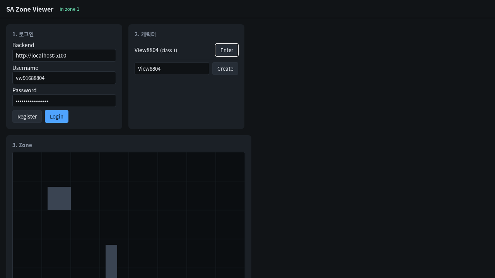

# 12 (3b단계) 브라우저 뷰어: 같은 프로토콜로 접속해 동기화를 눈으로 본다

## 배경과 목표
봇은 숫자로 판정하지만 사람이 "정말 서로 보이며 부드럽게 움직이나"를 확인할 창이 없다. 이 뷰어는 게임 클라이언트가 아니라 **서버를 들여다보는 도구**다. 브라우저가 11의 WebSocket으로 Gateway에 붙고, 같은 `.proto`를 그대로 읽고, 보간 버퍼·인위적 유실·외삽 스위치로 설계 노트 02의 내용(스냅샷 주기와 보간, 유실 시 보정)을 손으로 실험한다. 완료 조건: 브라우저에서 가입 → 로그인 → 캐릭터 생성 → 입장 → 이동까지 되고 스냅샷 모순이 0이다. 이것으로 3b단계가 끝난다.

## 고민한 선택지와 결정
| 주제 | 선택지 | 결정 |
|---|---|---|
| 프레임워크 | React 등 / 순수 HTML·ES 모듈 + canvas | 순수. 빌드 단계 없이 저장소 루트를 정적 서버로 띄우면 끝(`scripts/viewer.sh`) |
| 메시지 | 뷰어용 JSON API / protobuf.js로 같은 `.proto`를 런타임에 읽기 | 같은 `.proto`. 계약의 단일 출처가 브라우저까지 이어진다. 생성 코드를 커밋하지 않는다 |
| 다른 엔티티 그리기 | 받은 위치 그대로 / 버퍼만큼 과거를 보간, 데이터가 늦으면 외삽 또는 정지 | 보간 버퍼(기본 200 ms). 어떤 엔티티가 보간·외삽·정지 중인지 색과 HUD 수치로 보인다 |
| Backend 접근 | 같은 출처로 프록시 / CORS 허용 | CORS. 허용 출처는 설정(`Cors:AllowedOrigins`)이고 기본값은 비어 있다(브라우저 접근 없음) |
| Gateway 주소 | 뷰어에 하드코딩 / 입장 응답에 WebSocket 포트를 함께 | 입장 응답. 배포마다 포트가 달라도 뷰어는 그대로다 |
| 로컬 실행 | e2e 스크립트 재사용 / 띄워 두는 스택 스크립트 | `scripts/dev-stack.sh up|down|status`. 키를 세션 동안 유지해 재시작해도 로그인 상태가 이어진다 |

## 구현
- `tools/viewer/`: `index.html`, `js/api.js`(Backend HTTP), `js/net.js`(WebSocket + protobuf.js), `js/world.js`(엔티티 타임라인·보간), `js/render.js`(canvas), `js/main.js`, `style.css`, README
- Backend: `Infrastructure/Http/Cors*`, `WorldDirectoryOptions`에 Gateway WebSocket 포트, 입장 응답에 포트, 통합 테스트 하네스 한 줄
- `scripts/dev-stack.sh`, `scripts/viewer.sh`
- 설계 노트 01·02: WebSocket을 "3b 예정"에서 실제 구조(공통 바이트 스트림 위의 두 연결)로 갱신
- README: 구조 표의 브라우저 뷰어, 네트워크 표의 CORS·WebSocket 포트, 대화형 실행 방법
- 이전 이력의 문서 커밋 중 README·CLAUDE.md 부분은 가져오지 않고 이 저장소의 README 규칙(만든 것만)에 맞게 다시 썼다

## 만난 문제
- 없음.

## 검증
- .NET: 단위 4개 + 통합 26개 통과, `dotnet format` 통과. C++는 바뀐 것이 없다(111개, 11과 같음).
- 헤드리스 Chromium(Playwright)으로 실제 접속: 가입 → 로그인 → 캐릭터 생성 → Enter → `in zone 1`, D 키로 이동해 위치가 바뀌고, 스냅샷 20개 적용·유실 0·**모순 0**·JS 오류 0.

## 남긴 것
- 전투(4단계)가 들어오면 뷰어에 공격 키와 HP 표시를 더한다.
- 이 PR로 3b단계가 끝난다. 0.2.0은 4단계(전투) 끝에 낸다.
