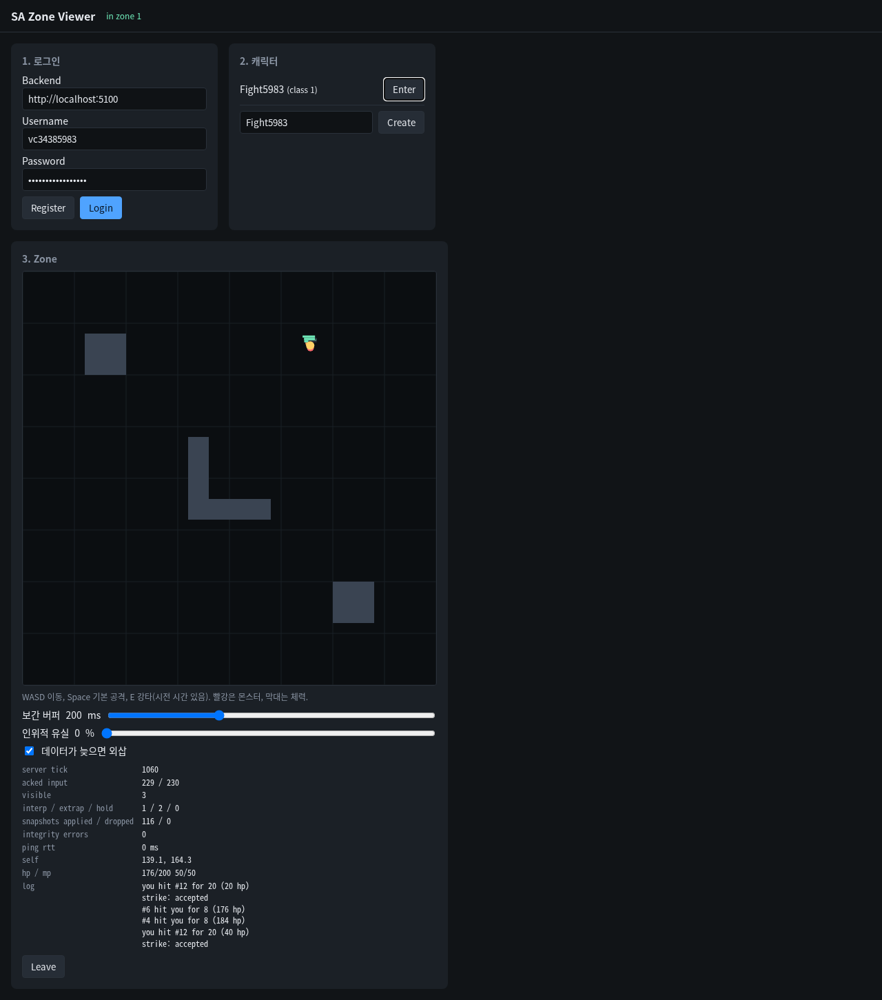

# 15 (4단계) 전투 호스트 연결: 스킬 요청을 받고 결과·피해·체력을 보낸다

## 배경과 목표
14에서 Zone 시뮬레이션은 스킬을 검증하고 피해를 계산하게 됐지만, 클라이언트는 아직 스킬을 보낼 수도 결과를 받을 수도 없었다. 이 PR은 그 사이를 잇는다. Zone 호스트가 클라이언트의 `CastSkill`을 시뮬레이션 명령으로 바꾸고, 시뮬레이션이 정한 수신자에게 명령 결과와 전투 이벤트를 보내고, 스냅샷에 체력을 싣는다. 브라우저 뷰어는 몬스터·투사체·체력 막대를 그리고 Space·E로 스킬을 쓴다. 완료 조건: 뷰어에서 몬스터에게 걸어가 스킬을 쓰면 수락·거절 결과와 피해가 오고, 몬스터를 처치할 수 있다.

## 고민한 선택지와 결정
| 주제 | 선택지 | 결정 |
|---|---|---|
| 결과를 보내는 시점 | 다음 스냅샷에 실어서 / 틱마다 이벤트 큐를 비워 바로 | 바로. 호스트가 매 틱 시뮬레이션의 이벤트 큐를 비운다. 스냅샷은 10 Hz라 결과가 최대 한 스냅샷 주기만큼 늦어지는 것을 피한다 |
| 수신자 결정 | 호스트가 관심 집합을 보고 / 시뮬레이션이 정한 수신자를 그대로 | 그대로. 이벤트마다 수신자 엔티티가 붙어 오고, 호스트는 그 엔티티의 세션을 찾아 보내기만 한다. 그 틱에 나간 수신자는 건너뛴다 |
| 거절 사유 표현 | 숫자 / 계약의 enum | 계약의 `RejectCode` enum. 시뮬레이션의 거절 사유가 하나도 빠짐없이 대응되는지 테스트로 확인한다 |
| 자원 노출 | 모든 엔티티의 체력·마나 / 체력은 보이는 모두, 마나는 자기만 | 체력은 보이는 엔티티 모두에게, 마나는 `SelfVitals`로 자기에게만. 다른 플레이어의 자원 상태를 필요 이상으로 내보내지 않는다 |
| 뷰어의 대상 선택 | 클릭 / 가장 가까운 몬스터 | 가장 가까운 몬스터. 뷰어는 서버를 들여다보는 도구라 입력을 단순하게 둔다. 서버 사거리보다 조금 넓게 고르므로 거절 경로도 자연스럽게 보인다 |

## 구현
- 계약 `server_messages.proto`: `CombatEvent`, `RejectCode`, `SelfVitals`, `EntityUpdate.hp`, `CommandResult.reject_code`를 enum으로
- `zone/server`: `codec`에 `CastSkill` → 시전 명령, 이벤트 → 서버 메시지 변환. `zone_host`가 틱마다 이벤트를 비워 수신자 세션으로 보낸다
- loadgen: 서버 메시지 switch에 `CombatEvent`를 더했다. switch는 모든 종류를 다루고 경고가 에러라서, 계약에 종류가 늘면 봇도 같은 PR에서 바뀌어야 빌드된다. 받은 이벤트를 쓰는 전투 봇 두뇌는 다음 PR
- 뷰어: 몬스터(빨강)·투사체·체력 막대, Space 기본 공격·E 강타, HUD 전투 로그와 체력·마나
- 테스트: 코덱 3개(시전 명령의 두 대상 종류, 이벤트 포장, 거절 사유 전부 대응), 호스트 1개(시전 결과가 다음 틱에 온다)
- README: 전투 절에 클라이언트 메시지 표, 구조 표의 뷰어
- 계약의 `CombatEvent` 주석이 "공격자와 피격자, 둘을 보는 모두에게 간다"였는데, 시뮬레이션은 공격자만 보이는 플레이어에게는 보내지 않는다. 실제 동작(피격자 자신, 피격자를 시야에 둔 플레이어, 공격자)으로 고쳤다

## 만난 문제
- 옮겨 온 커밋에 모르는 클래스 거절 테스트가 들어 있었는데, 14에서 같은 동작의 테스트를 이미 넣었다. 14를 준비할 때 이전 이력의 그 피처 커밋만 보고 "거절 테스트가 없다"고 판단했고, 다음 피처까지는 보지 않았다. 14의 테스트가 더 많은 것을 확인하므로 옮겨 온 쪽을 지웠고, 14의 피처 문서 문장도 바로잡았다.

## 검증
- C++: dev 135개 통과(14보다 4개 늘었다. 새 테스트 4개를 더하고 겹친 1개를 지웠다), clang-tidy 경고 0, ASan·UBSan 135개 통과, 형식 검사 통과.
- end-to-end: 봇 5개 전원 입장, 정합성 오류 0, 실행 뒤 남은 세션 0.
- 헤드리스 Chromium으로 뷰어 전투 확인: 가입 → 입장 → 가장 가까운 슬라임 무리까지 걸어가 Space. 첫 시도는 사거리 밖이라 `REJECT_CODE_OUT_OF_RANGE`, 이어진 세 번은 수락되어 20씩 피해를 주고 세 번째에 처치. 그동안 슬라임들의 공격으로 체력이 200에서 152로 줄었다. 정합성 오류 0, JS 오류 0.

## 남긴 것
- 봇이 스스로 싸우는 두뇌(Fighter)와 전투 부하 프로필은 다음 PR에서 한다. 그것으로 4단계가 끝난다.
- 처치 보상(경험치·드롭)은 아직 없다. 처치 ID를 근거로 Backend가 보상을 기록하는 것은 5단계다.
